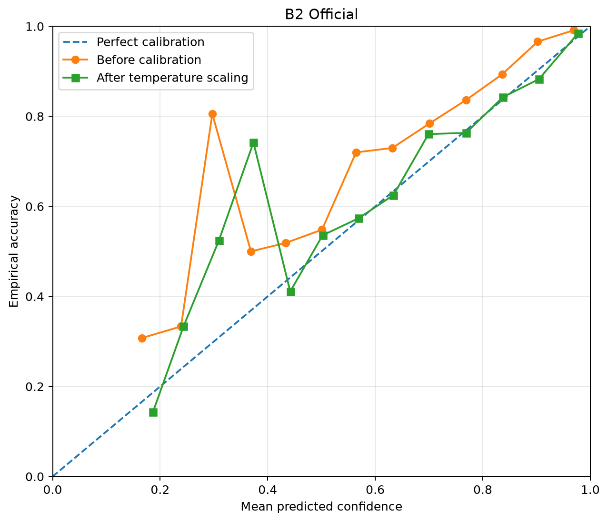
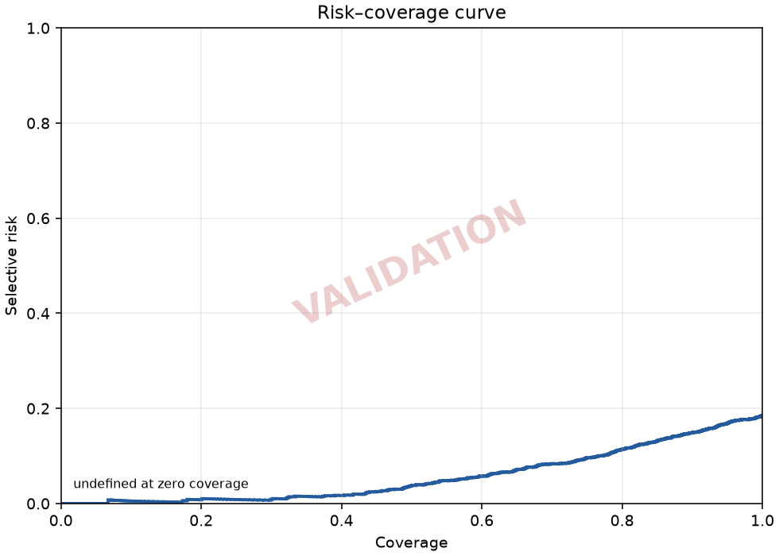

# DogBreedID — Kết quả Official Test tổng hợp

## 1. Mục tiêu và nguồn kết quả

Báo cáo phục vụ đồ án môn học và bàn giao nhóm, tổng hợp khả năng phân loại (E4), hiệu chỉnh xác suất (E6), phân loại có quyền từ chối (E7) và độ bền vững (E8) theo cấu hình đã khóa.

- **Run ID:** `task05-final-20261026-ea8c474981b14065af219fb43ee8e65e`.
- **Tập đánh giá:** Official Test, **1.934 ảnh, 30 lớp**.
- **Nguồn:** `e4_e6_metrics.json`, `selective_metrics.json`, `e8_metrics.json` và hai PNG đã xuất từ cùng run thành công.
- **Bản số liệu chia sẻ:** [official_metrics_summary.json](official_metrics_summary.json), chỉ trích xuất các trường tổng hợp bằng allowlist.
- **Tham khảo:** [Bàn giao nghiệm thu Task 05](../task05_final_acceptance_handoff.md).

Bước tổng hợp này chỉ đọc artifacts được cho phép; không chạy lại mô hình, không truy cập CSV hoặc ảnh Official Test gốc và không kiểm toán lại toàn bộ bundle. Các bảng dưới đây đều là kết quả Official, không đưa số liệu Validation vào so sánh.

## 2. E4 — Phân loại toàn tập

| Chỉ số | Giá trị gốc | Trình bày |
|---|---:|---:|
| Top-1 Accuracy | 0.8148913979530334 | **81,49%** |
| Top-5 Accuracy | 0.9953464269638062 | 99,53% |
| Macro-F1 | 0.8111032621745409 | 81,11% |

Top-1 đúng **1.576/1.934 ảnh**, đối chiếu từ tổng đường chéo confusion matrix và số đếm Clean của E8. Top-5 không thay thế Top-1.

**Mục tiêu Top-1 ≥85%: CHƯA ĐẠT.** Kết quả 81,49% thấp hơn mục tiêu khoảng **3,51 điểm phần trăm**. Selective Accuracy ở mục 4 không được dùng để tuyên bố đạt mục tiêu Top-1 toàn tập.

## 3. E6 — Temperature Scaling

Temperature cố định **0.80246283961825**, ECE dùng **15 bins**; không refit trong bước tổng hợp.

| Chỉ số | Trước Temperature Scaling | Sau Temperature Scaling |
|---|---:|---:|
| ECE | 0.07490139680737469 | 0.022949527667938605 |
| NLL | 0.549883447397119 | 0.5057778915666444 |
| Multiclass Brier Score | 0.27240292982570635 | 0.26257389767889505 |

Cả ba chỉ số đều giảm. ECE giảm từ **7,49%** xuống **2,29%**, khoảng **5,20 điểm phần trăm**. Artifact ghi `top1_prediction_unchanged=true`: Temperature Scaling giữ nguyên dự đoán Top-1.

*Hình 1. Biểu đồ reliability tổng hợp từ artifact của run Official; không chứa ảnh đầu vào hoặc định danh từng mẫu.*

## 4. E7 — Phân loại có quyền từ chối

Sử dụng Temperature **0.80246283961825**, threshold **0.5011672918550012**, quy tắc `confidence >= threshold`; artifact ghi `threshold_reselected=false`.

| Chỉ số | Giá trị gốc | Trình bày |
|---|---:|---:|
| Tổng ảnh | 1934 | 1.934 |
| ACCEPT | 1736 | 1.736 |
| REJECT | 198 | 198 |
| Đúng trong ACCEPT | 1478 | 1.478 |
| Coverage | 0.8976215098241985 | 89,76% |
| Selective Accuracy | 0.8513824884792627 | **85,14%** |
| Selective Risk | 0.14861751152073732 | 14,86% |
| AURC | 0.05665629453149997 | 0.05665629453149997 |

AURC theo quy ước artifact: `grouped right-step over confidence tie groups`.

**81,49% là Top-1 trên toàn bộ 1.934 ảnh; 85,14% là Selective Accuracy chỉ trên 1.736 ảnh ACCEPT.** Độ chính xác trên nhóm ACCEPT cao hơn khoảng 3,65 điểm phần trăm, đổi lại hệ thống từ chối 198 ảnh (10,24%).

*Hình 2. Bản sao nguyên bytes của `risk_coverage_curve.png` trong bundle run Official. **Lưu ý lỗi nhãn nguồn: hình có watermark “VALIDATION”.** Không dùng watermark này làm bằng chứng về split; bảng E7 lấy từ JSON Official của cùng run. Hình cần trưởng nhóm xử lý nhãn hoặc quyết định cách trình bày trước khi công bố. Bước này không chỉnh ảnh, không thay artifact gốc và không đưa metrics Validation vào báo cáo.*

## 5. E8 — Robustness

Accuracy Drop được giữ đúng định nghĩa **Clean Accuracy − Corrupted Accuracy**, là chênh lệch có dấu; cột điểm phần trăm bằng Accuracy Drop ×100.

| Điều kiện | Số đúng / 1.934 | Accuracy gốc | Accuracy (%) | Accuracy Drop gốc | Drop (điểm phần trăm) |
|---|---:|---:|---:|---:|---:|
| Clean | 1576 | 0.8148914167528438 | 81,49 | — | — |
| Gaussian Blur | 1261 | 0.6520165460186143 | 65,20 | 0.16287487073422957 | 16,29 |
| Gaussian Noise | 1403 | 0.7254395036194415 | 72,54 | 0.08945191313340228 | 8,95 |
| Occlusion | 1478 | 0.7642192347466391 | 76,42 | 0.05067218200620471 | 5,07 |

Severity trong artifact: Blur kernel **7**, sigma **1.5**; Noise mean **0**, std **0.05**, clamp **[0,1]**; Occlusion hình vuông, cạnh bằng **0.30** cạnh ảnh, fill RGB **[0.5,0.5,0.5]**, vị trí deterministic theo ảnh.

Gaussian Blur làm giảm accuracy lớn nhất trong ba corruption ở severity đang xét; Occlusion giảm ít nhất. Không suy rộng thứ hạng này sang mọi loại hoặc mức độ biến đổi khác.

Giữ nguyên độ chính xác số của từng artifact: E4 Top-1 là `0.8148913979530334`, còn E8 Clean và Top-1 trong calibration là `0.8148914167528438` (tỷ lệ 1.576/1.934). Chênh lệch khoảng `1.88e-8` ở biểu diễn số không đổi kết luận 81,49%; bản JSON chia sẻ không tự sửa hay đồng nhất các giá trị này.

## 6. Nhận xét, hạn chế và phạm vi chia sẻ

- Mục tiêu Top-1 ≥85% chưa đạt; Top-5 cao và Selective Accuracy 85,14% không thay đổi kết luận này.
- Calibration cải thiện ECE, NLL và Brier trên tập đã đánh giá; E7 đánh đổi coverage để tăng accuracy của nhóm ACCEPT.
- Kết quả chỉ phản ánh một lượt Official Test theo protocol đã khóa, không chứng minh hiệu năng trên mọi phân bố ảnh, thiết bị hoặc môi trường thực tế. Không bổ sung khoảng tin cậy hay kết quả đa lượt khi chưa có bằng chứng.
- Báo cáo này không thực hiện tuning, refit, retrain hoặc đánh giá lại. Thông số và artifacts lịch sử được giữ nguyên.
- JSON chia sẻ chỉ có chỉ số và số đếm tổng hợp; không xuất image IDs, nhãn từng ảnh, logits, probabilities, CSV từng mẫu, đường dẫn ảnh/local, checkpoint hay claim ledger. Không xuất các mảng per-sample có trong JSON nguồn E8.
- Hai PNG đã được kiểm tra trực quan là biểu đồ tổng hợp, không thấy ID ảnh, đường dẫn local hay thông tin gắn với từng mẫu; text metadata PNG chỉ ghi phần mềm Matplotlib. Riêng watermark “VALIDATION” ở Hình 2 là vấn đề trình bày còn chờ trưởng nhóm quyết định trước khi công bố.

**Trạng thái:** Bộ tổng hợp chuẩn bị cho trưởng nhóm review; chưa stage, commit, push hoặc tạo PR trong bước này.
