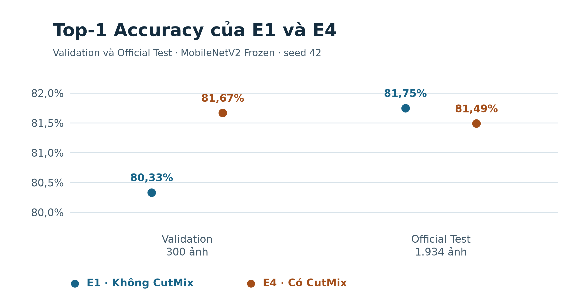
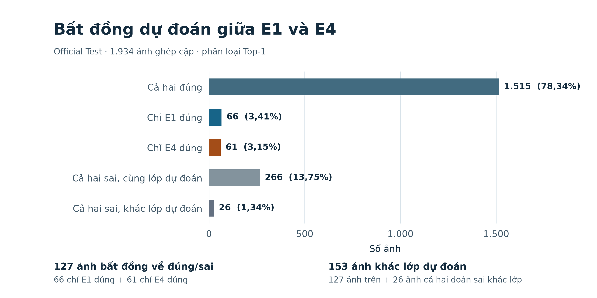

# DogBreedID — Đối chứng hậu nghiệm E1 và E4 trên Official Test

## Mục tiêu và thiết kế

Nghiên cứu xem xét Top-1 Accuracy của hai checkpoint thay đổi bao nhiêu khi so sánh E1 không dùng CutMix với E4 dùng CutMix trên cùng ảnh Official Test. Top-5 Accuracy, Macro-F1 và các nhóm dự đoán bất đồng bổ sung thông tin về sự khác biệt giữa hai mô hình.

| Đặc điểm | E1 | E4 |
| --- | --- | --- |
| Kiến trúc | MobileNetV2 Frozen | MobileNetV2 Frozen |
| Seed huấn luyện | 42 | 42 |
| CutMix khi huấn luyện | Tắt | Bật, `alpha = 1,0`, xác suất `0,5` |
| Batch size khi inference Official | 8 | 32 |

Hai mô hình dùng checkpoint đã chọn trên Validation và được đánh giá trên cùng **1.934 ảnh thuộc 30 lớp**. Quy trình xác minh đối chiếu từng cặp ảnh, nhãn thật, class mapping và snapshot trước khi tính thống kê. Tiền xử lý cho cả hai là RGB → Resize(256) → CenterCrop(224) → ToTensor → ImageNet Normalize. Top-1 và Top-5 lần lượt đo tỷ lệ nhãn thật xuất hiện ở hạng đầu hoặc trong năm hạng đầu. Macro-F1 lấy trung bình đều F1 của 30 lớp.

E1 dùng batch 8 theo cấu hình đã duyệt cho lượt nghiên cứu, còn kết quả E4 kế thừa từ Task 05 với batch 32. Đây là kích thước nhóm ảnh khi thực thi inference ở chế độ đánh giá, giữ cùng tiền xử lý và cùng quy tắc xếp hạng theo từng ảnh. Nghiên cứu chỉ sử dụng hai bộ dự đoán đã lưu và không thực hiện thí nghiệm độ nhạy theo batch size.

## Kết quả Validation và Official Test

Quy ước chênh lệch là **E4 − E1**. Accuracy và chênh lệch Accuracy được tính từ số đếm đúng và mẫu số của từng tập, sau đó mới làm tròn để trình bày. Macro-F1 dùng thang từ 0 đến 1. Các số Validation là kết quả seed 42 đã xác minh trước nghiên cứu. Các số Official được đối chiếu với kết quả ghép cặp đã xác minh của Run 02.

| Tập đánh giá | Chỉ số | E1 | E4 | E4 − E1 |
| --- | --- | ---: | ---: | ---: |
| Validation (300 ảnh) | Top-1 | 80,3333% (241/300) | 81,6667% (245/300) | +1,3333 điểm % |
| Validation (300 ảnh) | Top-5 | 99,0000% (297/300) | 98,6667% (296/300) | −0,3333 điểm % |
| Validation (300 ảnh) | Macro-F1 | 0,7996395749895547 | 0,815099216821925 | +0,01545964 |
| Official Test (1.934 ảnh) | Top-1 | 81,7477% (1.581/1.934) | 81,4891% (1.576/1.934) | −0,2585 điểm % |
| Official Test (1.934 ảnh) | Top-5 | 99,6381% (1.927/1.934) | 99,5346% (1.925/1.934) | −0,1034 điểm % |
| Official Test (1.934 ảnh) | Macro-F1 | 0,8149433194289545 | 0,8111032621745409 | −0,00384006 |

## Kiểm định ghép cặp trên Official Test

Chênh lệch Top-1 quan sát được là `(61 − 66) / 1934 × 100`, tương ứng **−0,2585 điểm phần trăm**. Paired bootstrap dùng 20.000 lần lấy mẫu có hoàn lại, mỗi lần lấy 1.934 cặp dự đoán, với seed bootstrap 42. Khoảng phân vị 95% cho chênh lệch trải từ **−1,3961 đến +0,8790 điểm phần trăm**.

Kiểm định McNemar exact hai phía dùng 127 cặp có đúng một mô hình phân loại đúng. Dưới giả thuyết hai hướng bất đồng có xác suất bằng nhau, kết quả là **p = 0,7227870831457865**. Ở ngưỡng 0,05, dữ liệu chưa đủ bằng chứng về khác biệt Top-1 giữa hai checkpoint. Khoảng tin cậy chứa 0 và vẫn tương thích với các chênh lệch nhỏ theo cả hai hướng. Nghiên cứu chưa thiết lập biên tương đương để kiểm định tính tương đương.

## Bất đồng dự đoán

| Nhóm Top-1 | Số ảnh | Tỷ lệ trên 1.934 ảnh |
| --- | ---: | ---: |
| Cả hai đúng | 1.515 | 78,34% |
| Chỉ E1 đúng | 66 | 3,41% |
| Chỉ E4 đúng | 61 | 3,15% |
| Cả hai sai, cùng lớp dự đoán | 266 | 13,75% |
| Cả hai sai, khác lớp dự đoán | 26 | 1,34% |
| **Tổng** | **1.934** | **100,00%** |

**127 ảnh (6,57%) bất đồng về đúng/sai**, gồm 66 ảnh chỉ E1 đúng và 61 ảnh chỉ E4 đúng. **153 ảnh (7,91%) khác nhãn dự đoán Top-1**, gồm 127 ảnh trên và 26 ảnh mà cả hai đều đoán sai nhưng chọn hai lớp khác nhau. Tổng Top-1 đúng được đối chiếu từ nhóm cả hai đúng cộng nhóm chỉ một mô hình đúng, lần lượt là 1.581 cho E1 và 1.576 cho E4.

## Kết quả theo lớp

[Bảng 30 lớp](e1_e4_class_metrics.csv) ghi support, số ảnh dự đoán vào từng lớp, số đúng Top-1/Top-5, Top-5 Accuracy, precision, recall và F1. Các tỷ lệ trong CSV dùng thang từ 0 đến 1. Support là số ảnh có nhãn thật thuộc lớp đó. Recall là tỷ lệ Top-1 đúng trong support của lớp.

Theo số ảnh Top-1 đúng, E4 tăng nhiều nhất ở **Siberian Husky** (38/92 lên 50/92) và **EntleBucher** (80/102 lên 91/102), đồng thời giảm nhiều nhất ở **Appenzeller** (43/51 xuống 33/51) và **Border Collie** (44/50 xuống 35/50). Đây là các chênh lệch mô tả trên tập ảnh đã đánh giá.

[Ma trận E1](../figures/e1_official_confusion_matrix.png) và [ma trận E4](../figures/e4_official_confusion_matrix.png) cùng dùng hàng là lớp thật, cột là lớp dự đoán Top-1 và chung thang màu số đếm. Mỗi ma trận có tổng 1.934 ảnh, với tổng đường chéo lần lượt là 1.581 và 1.576. Cộng số đúng Top-5 trong bảng theo lớp cho kết quả tương ứng 1.927 và 1.925.

## Giới hạn và kết luận

Phân tích dùng hai checkpoint ở **một seed** trên một snapshot Official Test. Bootstrap phản ánh độ bất định theo cặp ảnh cho hai checkpoint cố định. Kết quả chưa ước lượng độ biến thiên giữa các lần huấn luyện và chưa thiết lập quan hệ nhân quả có thể suy rộng cho CutMix. Các khác biệt theo lớp mang tính thăm dò và chưa được kiểm định riêng.

Trên Validation, E4 cao hơn về Top-1 và Macro-F1. Trên Official Test, cả hai chỉ số đảo chiều với chênh lệch nhỏ, và McNemar exact chưa cho thấy khác biệt Top-1 có ý nghĩa thống kê. Kết quả giới hạn ở cặp checkpoint seed 42 này và chưa đủ để kết luận CutMix luôn kém hơn.

### Đoạn đề xuất cho Chương 4

> Trong đối chứng hậu nghiệm trên 1.934 ảnh Official Test thuộc 30 lớp, MobileNetV2 Frozen seed 42 đạt Top-1 Accuracy 81,75% với E1 không dùng CutMix và 81,49% với E4 dùng CutMix. Chênh lệch E4 − E1 là −0,26 điểm phần trăm, với khoảng tin cậy bootstrap ghép cặp 95% từ −1,40 đến +0,88 điểm phần trăm và p = 0,723 theo McNemar exact hai phía. Kết quả chưa cho thấy khác biệt Top-1 có ý nghĩa thống kê cho cặp checkpoint được khảo sát. Kết luận về ảnh hưởng của CutMix qua các lần huấn luyện cần bằng chứng từ nhiều seed.
