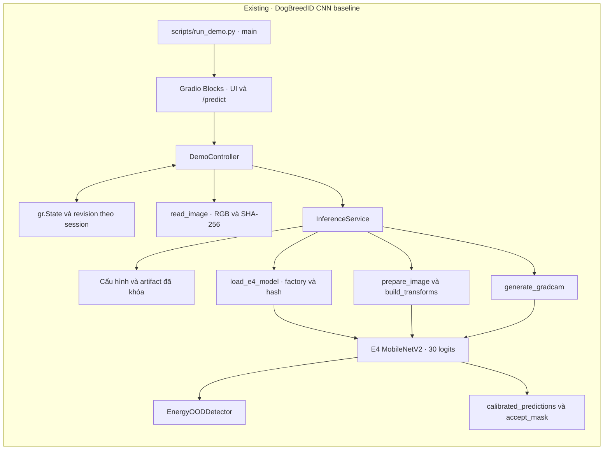
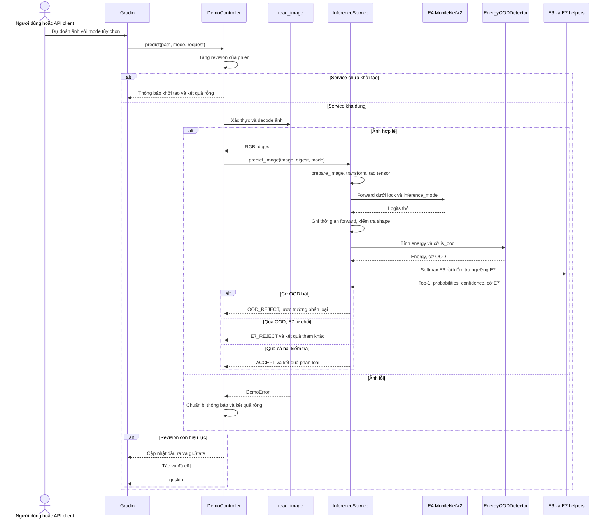
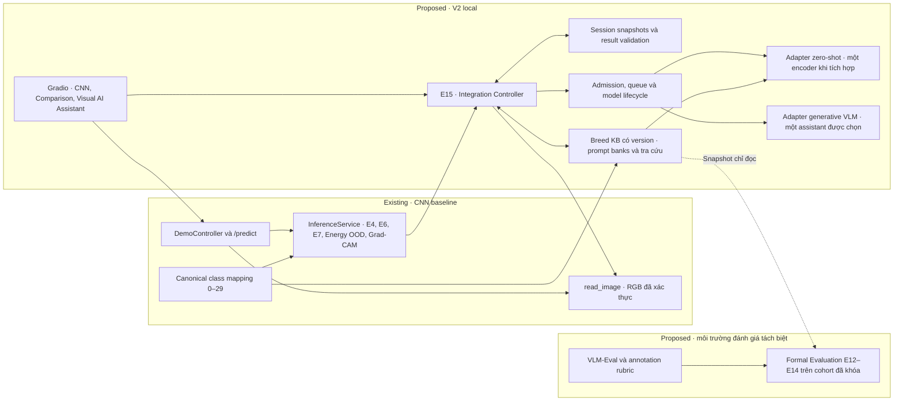
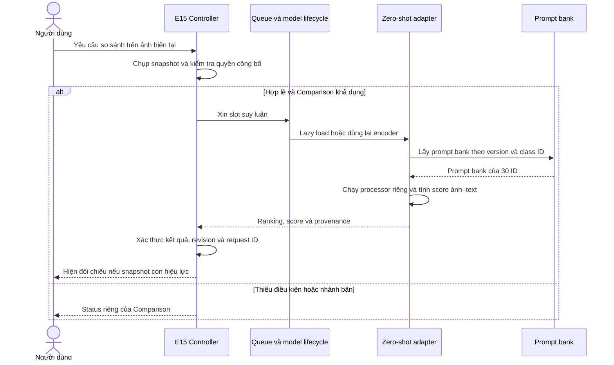
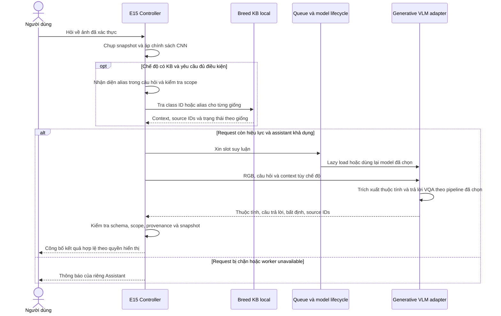
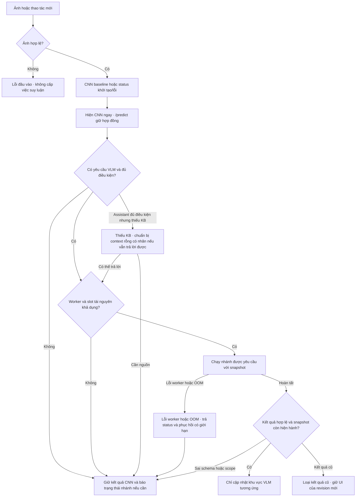

# DogBreedID V2 — Hybrid CNN–VLM with Knowledge-Augmented Visual Understanding

**APPROVED FOR IMPLEMENTATION PLANNING — PENDING PILOT**

Phê duyệt này áp dụng cho thiết kế và lập kế hoạch triển khai. Cấu hình thực nghiệm chờ Research Protocol Lock, còn khả năng hoạt động của VLM chờ kiểm chứng qua pilot.

**Task 08.01 · Phase 2.1 · System Architecture Design**

Thiết kế mở rộng DogBreedID bằng hai nhánh tùy chọn gồm phân loại zero-shot để đối chiếu và trợ lý ảnh tiếng Việt có truy xuất kiến thức. E4, E6, E7, Energy OOD và Grad-CAM tiếp tục phục vụ luồng phân loại chính. Phạm vi bàn giao là thiết kế kiến trúc.

| Mốc | Giá trị |
| --- | --- |
| Repository | `DGiang1126/dogbreedid-cv-project` |
| Worktree thiết kế | `dogbreedid-vlm-protocol` trên nhánh `research/vlm-protocol` |
| Baseline đã đối chiếu | `v1.0.0-cnn-stable` → `b7d880506b96168b0e335f3a455be3a7b2bdf77e` |

## 1. AS-IS — Kiến trúc đã xác minh

### 1.1. Cấu trúc và ranh giới

| Khu vực hiện có | Trách nhiệm |
| --- | --- |
| `scripts/run_demo.py` | `main()` parse `--checkpoint`, `--device`, `--port`, gọi `create_app()` và khởi chạy Gradio tại `127.0.0.1`, `share=False`, `max_file_size="10mb"`. Queue có `default_concurrency_limit=1`. |
| `app/gradio_app.py` | `create_app()` khởi tạo một `InferenceService`. `build_app()` tạo Gradio Blocks, `DemoController`, `gr.State(None)` và đăng ký các event. Controller dịch dữ liệu service sang UI/API và quản lý revision theo phiên. |
| `app/inference_service.py` | Giữ một E4 model dùng chung cho dự đoán và Grad-CAM. Kiểm tra cấu hình, đọc ảnh, tạo preview, tiền xử lý và tổng hợp quyết định. Một `threading.Lock` của service tuần tự hóa lượt forward E4 và việc tạo Grad-CAM. |
| `src/models/`, `src/inference/`, `src/data/` | Factory và MobileNetV2, loader checkpoint dùng chung, transform từ cấu hình. Demo gọi loader, tách khỏi batch runner đánh giá. |
| `src/ood/`, `src/selective/`, `src/calibration/`, `src/explainability/` | Energy OOD, xác suất đã hiệu chỉnh và selective prediction, công cụ nghiên cứu calibration, Grad-CAM. Đường chạy demo áp dụng E6 bằng `calibrated_predictions()` trong `src/selective/threshold.py`. |
| `configs/` và các cấu hình/artifact khóa | `configs/data.yaml` và `configs/experiments/e4_cutmix.yaml` định nghĩa transform và model. `configs/inference.yaml` hiện chứa `status: TODO`. Demo lấy tham số từ các hằng và kiểm tra artifact trong `app/inference_service.py`. |
| `tests/`, `docs/`, `README.md`, `requirements.txt` | Test, hồ sơ nghiệm thu, hướng dẫn demo và dependency chung. Demo dùng Gradio `>=6.0,<7` cùng runtime PyTorch/torchvision. Kiến trúc VLM dưới đây là đề xuất. |

### 1.2. AS-IS Component Diagram

### 1.3. Khởi tạo và xử lý ảnh

- `InferenceService.__init__()` gọi `_artifacts()` và `_ood_detector()`. `_artifacts()` đọc `data/metadata/class_mapping.json` dưới dạng object có đúng các khóa chuỗi `"0"` đến `"29"` và 30 tên khác nhau, không rỗng. Danh sách tên được tạo theo thứ tự ID số. `class_id` là index của logits và là khóa nối sang KB đề xuất. Hợp đồng được xác minh từ source và tài liệu khóa.
- Demo kiểm tra provenance và giá trị trong `outputs/metrics/E6/temperature.json`, `outputs/metrics/E7/threshold.json` và `outputs/metrics/OOD/energy_threshold.json`, gồm split `calibration` và các tham số liên quan theo từng artifact. `_ood_detector()` còn kiểm tra checkpoint hash tham chiếu, quy tắc so sánh và cờ `ood_200_used=false`.
- `load_e4_model()` dùng cấu hình E4 MobileNetV2 Frozen + CutMix, 30 lớp, checkpoint seed 42 mặc định `outputs/checkpoints/E4/seed_42/best.pt`. SHA-256 yêu cầu là `73df0cc1c5b16866d4facc910f3e4d3ab481e3f12f1681a59fa7d61e3845c47b`. Loader dựng kiến trúc với `weights="none"` trên bản sao cấu hình trong bộ nhớ, nạp checkpoint vào CPU bằng `weights_only=True`, dùng `load_state_dict(strict=True)`, rồi chuyển đến device và gọi `eval()`. `auto` chọn CUDA khi khả dụng, còn lại dùng CPU. Yêu cầu CUDA tường minh khi CUDA không khả dụng tạo `DemoError`.
- `read_image()` nhận một filepath, kiểm tra file tồn tại và giới hạn `10 × 1024²` byte trước và sau khi đọc. PIL xác định định dạng từ nội dung, chỉ chấp nhận JPEG/PNG/WebP, kiểm tra kích thước dương và tối đa 25 triệu pixel trước decode, bắt lỗi/cảnh báo decompression bomb, decode rồi chuyển RGB. Digest là SHA-256 của **bytes ảnh gốc**, dùng cho đối chiếu ảnh trong phiên.
- `standard` là mặc định. `prepare_image()` truyền ảnh RGB trực tiếp vào `build_transforms(config, "inference")`. Transform dùng Resize(256) giữ tỷ lệ theo cạnh ngắn, CenterCrop(224), ToTensor và ImageNet Normalize với mean `[0.485, 0.456, 0.406]`, std `[0.229, 0.224, 0.225]`. `fit` thu bicubic theo tỷ lệ để cạnh dài đạt 224, cạnh ngắn tối thiểu 1 pixel, rồi đặt giữa vùng crop trên canvas 256 × 256 màu RGB `(124, 116, 104)` trước cùng transform E4. Đây là tùy chọn padding thử nghiệm của demo. `InferenceService.preview()` cho ảnh RGB trước ToTensor/Normalize. UI hiển thị ảnh gốc và giữ component preview 224 × 224 ở trạng thái ẩn.

### 1.4. Thứ tự tính toán và ưu tiên quyết định

`InferenceService.predict_image()` tạo tensor `[1,3,224,224]`, chạy forward E4 trong `torch.inference_mode()` dưới lock và kiểm tra logits có shape `[1,30]`. `latency_ms` đo lượt forward, có đồng bộ CUDA khi cần. Logits thô được dùng lần lượt cho hai phép tính độc lập về mặt đầu vào.

1. `EnergyOODDetector.predict()` tính `energy = -T × logsumexp(logits / T)` với `T=1.0`, đánh dấu OOD khi `energy > -0.6801182939636002`. Điểm bằng ngưỡng qua kiểm tra OOD.
2. `calibrated_predictions()` tính softmax ổn định với E6 `T=0.80246283961825` và lấy Top-1 theo argmax logits gốc. `accept_mask()` kiểm tra E7 với `confidence >= 0.5011672918550012`. Hai phép tính E6/E7 vẫn diễn ra khi cờ OOD là `true`. Chỉ sau đó, service áp dụng bảng ưu tiên trả kết quả dưới đây.

| Ưu tiên | Điều kiện | Status và kết quả |
| --- | --- | --- |
| 1 | Energy vượt ngưỡng | `OOD_REJECT`, `accepted=false`. Service giữ latency, digest, mode và chẩn đoán `ood`. Các trường `class_id`, `name`, `confidence`, `top5` vắng mặt. UI ẩn kết quả giống, confidence, Top-5 và Grad-CAM. |
| 2 | Qua OOD, confidence dưới ngưỡng E7 | `E7_REJECT`, `accepted=false`. Service giữ các trường phân loại. UI hiện thông báo chưa đủ tự tin, confidence và Top-5 tham khảo. Grad-CAM vẫn có thể giải thích lớp mục tiêu trong phiên hiện hành. |
| 3 | Qua OOD, confidence đạt ngưỡng E7 | `ACCEPT`, `accepted=true`. UI hiện tên giống Top-1, confidence và Top-5, cho phép yêu cầu Grad-CAM. |

`top5` được xếp theo xác suất giảm dần bằng sort ổn định và ánh xạ sang tên canonical. Nhận diện ngoài phạm vi và thiếu tự tin là hai nguyên nhân từ chối riêng biệt.

### 1.5. CNN Inference Sequence

`DemoController.predict()` dừng sớm nếu thiếu service, trước cả bước đọc ảnh. Lỗi trong lượt forward, hậu xử lý hoặc chuyển trạng thái đi theo đường trả thông báo lỗi của controller.

### 1.6. Grad-CAM, phiên và lỗi

- **Grad-CAM.** `DemoController.explain()` kiểm tra revision trong `gr.State`. `InferenceService.explain()` yêu cầu dự đoán hiện hành, từ chối `OOD_REJECT` và xác thực lại mode cùng digest sau khi đọc ảnh. Service tái lập cùng transform, rồi gọi `generate_gradcam()` dưới lock, bên ngoài `torch.inference_mode()`. Grad-CAM chạy forward mới trên chính E4, lấy gradient của score `class_id` đối với output của Conv2d cuối mặc định, chuẩn hóa heatmap và bỏ hook sau khi dùng. Service vẽ overlay màu jet trên preview RGB 224 × 224 với tỷ trọng ảnh 55%, heatmap 45%. Đây là tín hiệu hỗ trợ quan sát vùng ảnh ảnh hưởng đến score.
- **Revision.** `DemoController._revision()` dùng `request.session_hash`, lock riêng và bộ nhớ `(revision, last_seen, previous_input)`. Predict mở revision mới, Clear vô hiệu tác vụ đang chờ và Upload/đổi mode đối chiếu selection. Cặp path/mode trùng chỉ trì hoãn kết luận cho đến khi digest được xác minh. `Future` chuyển kết quả digest của predict đang decode, với thời gian chờ nằm ngoài session lock. `expected_revision` bảo vệ thao tác mới hơn khỏi validation chậm. Bytes bị thay tại cùng path làm mất hiệu lực kết quả cũ, còn event đến trễ với cùng ảnh/mode có thể giữ dự đoán. Handler kiểm tra revision trước khi xuất kết quả và dùng `gr.skip()` khi lỗi thời. Khi bản đồ vượt 1.000 mục, controller dọn các mục quá một giờ. Nếu request thiếu `session_hash`, controller trả revision `None`.
- **Event và lỗi.** Upload, xóa file, đổi mode và Clear chạy ngoài queue, có khai báo hủy event predict/explain. Kiểm tra revision bảo vệ cả khi tác vụ đã bắt đầu. Clear giữ mode. Lỗi dự kiến được chuyển thành `DemoError` với thông báo tiếng Việt. `create_app()` dựng UI có thông báo nếu khởi tạo service gặp `DemoError`. Lỗi không dự kiến tại các handler predict/explain được ghi log và trả thông báo chung. Lỗi predict xóa kết quả cũ, còn lỗi explain giới hạn ở đầu ra Grad-CAM.

### 1.7. Hợp đồng API và bằng chứng hồi quy

Endpoint Gradio local `/predict` dùng chính `DemoController.predict()`. Input là một file ảnh và tham số `mode` tùy chọn (`standard` mặc định, `fit` tùy chọn). Client nhận bảy giá trị theo thứ tự gồm status Markdown, giống hiển thị, confidence, latency, Top-5, ảnh Grad-CAM, chú thích Grad-CAM. Hai đầu ra Grad-CAM rỗng sau predict. Giống và confidence là text hiển thị, Top-5 dùng output của `gr.Label`. Giá trị thứ tám của callback là `gr.State` nội bộ. Explain, Select Image và Clear là các event riêng tư.

| Bằng chứng đã đọc | Phạm vi xác minh |
| --- | --- |
| [tests/test_gradio_app.py](../../../tests/test_gradio_app.py) · `test_predict_through_actual_gradio_http()`, `test_gradio_event_contract()` | Hợp đồng Gradio HTTP, mặc định `standard`, mode `fit`, bảy output, event private và xử lý ảnh lỗi. |
| [tests/test_gradio_app.py](../../../tests/test_gradio_app.py) · `test_locked_artifacts_and_model_loaded_once()`, `test_standard_is_default_and_bit_exact_with_frozen_e4()`, `test_fit_gradcam_uses_identical_model_tensor_and_preview()` | Artifact khóa, tái sử dụng model và nhất quán tensor ở các đường gọi. |
| [tests/test_gradio_app.py](../../../tests/test_gradio_app.py) · `test_three_decision_states_and_energy_diagnostics()`, `test_ood_reject_hides_top1_top5_and_gradcam()`, `test_e7_reject_keeps_its_own_meaning()` | Ưu tiên OOD ngay cả khi E7 đủ điểm, cùng hành vi UI và Grad-CAM của hai loại reject. |
| [tests/test_gradio_app.py](../../../tests/test_gradio_app.py) · `test_inflight_result_cannot_restore_invalidated_outputs()`, `test_replaced_file_at_same_path_invalidates_prediction()`, `test_ood_state_is_isolated_between_sessions()` | Vô hiệu kết quả cũ và cách ly phiên. |
| [tests/test_transforms.py](../../../tests/test_transforms.py), [tests/test_gradcam.py](../../../tests/test_gradcam.py), [tests/test_ood_detector.py](../../../tests/test_ood_detector.py), [tests/test_selective_prediction.py](../../../tests/test_selective_prediction.py), [tests/test_calibration.py](../../../tests/test_calibration.py) | Transform, Grad-CAM với backbone frozen, biên Energy/E7, hiệu chỉnh và các điều kiện lỗi. |
| [Final regression acceptance](../results/final_regression_acceptance.md) | Hồ sơ ghi nhận commit nghiệm thu `bb1aa4501542f834d476c236a79ee5c498d4cef2`, 302 ca của ba tệp hồi quy và 1.292 ca pass của Full Tracked Suite, 0 failed/errors. Các ca thực thi hồi quy dùng fixture kiểm thử. Đây là kết quả đã ghi trong hồ sơ. |

## 2. TO-BE — Kiến trúc đề xuất

### 2.1. TO-BE Component Diagram

`/predict` tiếp tục gọi đường CNN hiện có. E15 nhận snapshot kết quả CNN từ server và chỉ điều phối tác vụ bổ sung từ hai khu vực VLM. Hai adapter dùng cùng ảnh RGB đã xác thực theo snapshot của phiên, mỗi adapter áp dụng processor riêng theo model/revision. Quyết định chính là bản ghi CNN do server tạo. Adapter chỉ nhận bản sao hoặc projection cần thiết.

### 2.2. Nhánh CNN

E4 MobileNetV2 seed 42, checkpoint hash, canonical mapping, cả hai mode hiện tại và transform tương ứng, E6, E7, Energy OOD, cũng như quy tắc Grad-CAM giữ nguyên theo mục 1. Cả khi VLM đồng thuận, bất đồng, timeout hay unavailable, E15 đều giữ nguyên status CNN và cách `/predict` công bố kết quả. Không có score fusion, re-ranking CNN hay hiệu chỉnh lại các ngưỡng trong E15.

### 2.3. Phân loại zero-shot

| ID | Encoder pretrained | Prompt bank |
| --- | --- | --- |
| E12-A | `google/siglip2-base-patch16-224` | Name |
| E12-B | `google/siglip2-base-patch16-224` | Morphology |
| E13-A | `qihoo360/fg-clip2-base` | Name |
| E13-B | `qihoo360/fg-clip2-base` | Morphology |

- Với từng encoder, dùng image processor và tokenizer tương thích revision đã pin. Chuẩn hóa ảnh, tokenization, phương thức tính score và phép tổng hợp prompt được xác minh theo adapter trong pilot. Ảnh gốc đã decode là đầu vào của adapter, CNN tiếp tục dùng mode riêng. Trong mỗi cặp A/B, khóa model, processor, ảnh, class order và scoring/aggregation, chỉ thay prompt bank.
- Gắn mỗi prompt với `class_id`. Xây dựng hoặc tái sử dụng biểu diễn text theo khóa gồm model/revision, tokenizer hoặc processor revision, mapping hash, prompt-bank hash và scoring profile. Chấm score cho đủ 30 ID, tổng hợp prompt theo từng ID theo quy tắc đã cố định, kiểm tra score hữu hạn và xếp hạng với tie-break theo ID. Kết quả mang định danh score và provenance. Score zero-shot chỉ dùng để xếp hạng trong cấu hình đã chọn, không diễn giải như confidence E6.
- Cả hai encoder chỉ dùng inference pretrained. Pilot kiểm tra tính khả thi của từng ứng viên trên ảnh phát triển. Formal Evaluation mới chạy E12-A/B và E13-A/B trên cùng cohort đã khóa để so sánh Top-1, Top-5, Macro-F1, mức đồng thuận và bất đồng với CNN, latency và peak memory theo protocol. Chỉ chọn tối đa một encoder và một profile triển khai sau Formal Evaluation và nghiệm thu. Cấu hình không đạt gate thì khu vực Comparison báo unavailable.

### 2.4. Zero-shot Classification Sequence

### 2.5. Trợ lý ảnh và Breed Knowledge Base

**Ứng viên chính** là `Qwen/Qwen3-VL-2B-Instruct`. **Ứng viên dự phòng** là `HuggingFaceTB/SmolVLM-500M-Instruct`. Pilot kiểm tra đường nạp cục bộ, tính tương thích và tài nguyên để đề xuất một model cho Protocol Lock. Adapter dùng processor và chat template tương ứng với revision đã duyệt. Cả hai chế độ chạy pretrained inference, không fine-tuning.

| ID | Điều kiện thí nghiệm |
| --- | --- |
| E14-A | Tắt truy xuất KB. Giữ vị trí context trong template ở trạng thái rỗng. |
| E14-B | Bật truy xuất KB. Chèn phần kiến thức đã xác minh và source IDs vào cùng vị trí context. |

Formal Evaluation chạy cặp E14-A/B với cùng model và revision, processor/tokenizer, ảnh, câu hỏi, template, generation settings, seed nếu dùng, output schema và validation policy. Dùng cùng CNN context nếu pipeline có dùng. Nếu pipeline đưa structured visual attributes trung gian vào VQA hoặc retrieval, trích xuất chúng từ đầu vào chung trước khi chèn KB context và dùng cùng một bản ghi thuộc tính cho cả hai biến thể. Biến số duy nhất là nội dung tại vị trí KB context. Ground-truth breed labels và evaluation answers chỉ dùng để chấm, không đi vào CNN context, thuộc tính trung gian, khóa truy xuất hoặc prompt runtime.

Báo cáo kết quả trên toàn bộ cohort đã khóa, ghi mẫu số theo cặp ảnh/câu hỏi và số kết quả theo từng biến thể. Báo số lượt retrieval miss, ambiguous, invalid output và inference failure, đồng thời giữ các lượt này trong phạm vi báo cáo. Ghi nguyên nhân của lượt B thiếu context hoặc lỗi và giữ định danh E14-B. Có thể phân tích bổ sung nhóm `retrieval hit` gồm các cặp mà E14-B truy xuất được đầy đủ các giống cần tra. Dùng cùng các cặp cho cả hai biến thể và ghi rõ mẫu số, tiêu chí chọn nhóm và phạm vi so với cohort đầy đủ. Cách tính metric với các trường hợp lỗi được chốt tại Protocol Lock.

**Hai thao tác hiểu ảnh.**

- **Structured visual attribute extraction** ghi nhận thuộc tính có kiểu từ ảnh, gồm tai, mõm, lông, màu hoặc họa tiết và dáng thân. Mỗi thuộc tính mang trạng thái `observed` hoặc `unknown` và dấu hiệu quan sát được hoặc lý do thiếu bằng chứng. Trường hợp ảnh bị che khuất, chất lượng thấp hoặc khó phân biệt chủ thể có thể trả `unknown`.
- **Visual question answering (VQA)** trả lời câu hỏi tiếng Việt dựa trên ảnh, nêu mức bất định và source IDs nếu dùng KB. Câu trả lời phân biệt chi tiết quan sát được với tri thức điển hình về giống.

Hai thao tác có thể dùng cùng generative VLM. Pilot so sánh single-pass (xuất cả hai kết quả trong một lần generate) và multi-pass (tách các lượt xử lý) về chất lượng, độ hợp lệ của schema, latency và bộ nhớ. Protocol Lock chốt pipeline sau benchmark. Cả hai biến thể E14-A/B dùng cùng pipeline đã khóa.

**Hợp đồng trợ lý đề xuất.** Input gồm ảnh, câu hỏi có giới hạn, chính sách hiển thị từ E15 và context KB có giới hạn khi bật. E15 kiểm tra schema, enum, giới hạn độ dài, trạng thái CNN và trích dẫn thuộc tập nguồn đã truy xuất. UI render nội dung dưới dạng text đã xử lý. Output không hợp lệ trả lỗi riêng. Sự hiện diện của source ID qua schema chỉ xác nhận provenance, còn độ đúng nội dung cần rubric.

**Breed Knowledge Base đề xuất.** Snapshot tệp dữ liệu cục bộ có version, đọc vào index trong bộ nhớ. Mỗi bản ghi có `class_id`, tên canonical, aliases có thể gồm Việt/Anh, thuộc tính hình thái đã xác minh cùng thuộc tính có thể biến thiên, name prompts, morphology prompts và tham chiếu nguồn đến cấp thuộc tính. Kiểm tra đủ 30 ID, khớp từng tên với canonical mapping, prompt có ID hợp lệ và thuộc tính có nguồn đã duyệt. Lưu ID nguồn, tên nguồn, URL và thông tin phiên bản/ngày truy cập nếu phù hợp.

**Nhận diện giống và truy xuất.**

1. Với `class_id` được cung cấp tường minh qua trường có kiểu, tra đúng ID canonical. Với câu hỏi tự nhiên, chuẩn hóa câu hỏi và alias theo Unicode NFC, casefold rồi chuẩn hóa NFC lại, trim và gộp khoảng trắng. Giữ dấu tiếng Việt. Dò tên canonical và alias theo chuỗi từ trọn vẹn, ưu tiên cụm dài nhất tại vị trí trùng lấn.
2. Index alias ánh xạ mỗi khóa chuẩn hóa tới tập canonical ID. Nhiều alias cùng chỉ một ID được gộp. Nếu một alias trỏ nhiều ID, ghi `ambiguous` và yêu cầu làm rõ khi phục vụ người dùng. Với mục cần tra mà không khớp, ghi `miss`. Trong Formal Evaluation, ghi trạng thái trên câu hỏi đã khóa và giữ nguyên đầu vào.
3. Với câu hỏi so sánh, thu thập mọi alias khớp, tra từng ID khác nhau theo thứ tự đề cập và gắn thông tin cùng source IDs cho từng giống. Giữ trạng thái riêng cho mục miss hoặc ambiguous và báo phần so sánh thiếu căn cứ. Phân bổ giới hạn context cố định cho các giống đã xác định.
4. Với câu hỏi về ảnh không nêu tên giống, có thể dùng ID CNN đã `ACCEPT` nếu chính sách E15 cho phép và ghi rõ nguồn của ID. Với câu hỏi đã nêu giống, alias miss hoặc ambiguous được giữ để làm rõ. Tra cứu dùng index khóa trong bộ nhớ. Vector database và LLM truy xuất riêng nằm ngoài phạm vi.

**Ranh giới dữ liệu.** KB runtime và hai prompt bank chỉ lấy thông tin hình thái và tên giống từ nguồn đã duyệt. VLM-Eval, annotation rubric, ground-truth answers theo ảnh/câu hỏi và split đánh giá thuộc môi trường đánh giá riêng, truy cập qua loader và đường dẫn riêng. Giữ snapshot KB cố định trước lượt so sánh, ngăn ghi ngược kết quả chấm vào KB hoặc prompt bank. Official Test, manifest, ảnh, nhãn và bundle protected không thuộc input hoặc output của V2, bao gồm pilot. Ảnh pilot phải thuộc tập phát triển được phép và tách biệt cohort non-Official sẽ dùng cho Formal Evaluation.

### 2.6. VLM Assistant with Knowledge Retrieval Sequence

### 2.7. E15 — Integration Controller và ba khu vực Gradio

1. **CNN Classification and Grad-CAM.** Tiếp tục chạy hành vi mục 1, kể cả khi hai nhánh VLM đều tắt. Kết quả chính mang status, class và điểm theo chính sách CNN tương ứng.
2. **CNN versus VLM Comparison.** Chạy khi người dùng yêu cầu và khi snapshot đã có kết quả CNN hiện hành đủ điều kiện. Hiện riêng score/ranking zero-shot, tên profile và badge đồng thuận hoặc bất đồng Top-1 theo `class_id`. Với E7 reject, xếp hạng chỉ tham khảo, nhận định CNN vẫn là chưa đủ tự tin.
3. **Visual AI Assistant.** Chạy theo câu hỏi, trình bày thuộc tính quan sát, câu trả lời tiếng Việt, mức bất định và nguồn nếu có. Tách nhãn trạng thái và thời gian xử lý của trợ lý khỏi khu vực CNN.

| Trạng thái CNN | Comparison | Assistant |
| --- | --- | --- |
| `ACCEPT` | Đối chiếu theo canonical ID và hiển thị bất đồng riêng nếu có. | Mô tả ảnh, trả lời VQA và có thể dùng ID CNN làm ngữ cảnh đã ghi nguồn. |
| `E7_REJECT` | Cho phép ranking tham khảo có cảnh báo, không phát sinh kết luận giống. | Mô tả ảnh, nêu bất định và tránh suy diễn giống từ ranking hoặc từ ngữ trong prompt. |
| `OOD_REJECT` | Chặn ranking giống. | Giới hạn ở câu hỏi mô tả quan sát chung. Chặn ứng viên giống và breed context cho ảnh. |
| CNN chưa chạy hoặc lỗi | Hiện trạng thái và yêu cầu kết quả CNN hợp lệ. | Với ảnh đã xác thực, chỉ trả lời quan sát chung và hiển thị trạng thái CNN riêng. Ảnh không hợp lệ dừng mọi nhánh. |

**Snapshot và cập nhật đồng thời.** Server cấp `request_id` cho từng tác vụ. Mỗi tác vụ giữ `session_id`, `image_digest`, `revision`, `cnn_mode`, nhánh và ID tác vụ mới nhất của nhánh đó trong phiên. Hai nhánh VLM có queue và trạng thái độc lập. Đổi ảnh, bytes ảnh, mode, Clear hoặc dự đoán CNN mới vô hiệu kết quả phụ thuộc, cả tác vụ chưa chạy. Câu hỏi mới vô hiệu lượt Assistant cũ trong cùng revision. Worker nhận ảnh đã được kiểm tra hoặc bản sao được quản lý vòng đời, không đọc lại path do client cung cấp. Hủy khi khả thi. Khi worker trả kết quả, controller so khớp identity, phiên, hết hạn, revision, digest, mode và request mới nhất, rồi kiểm tra scope và ghi kết quả bằng cùng một thao tác nhất quán theo phiên. Không lưu hoặc chia sẻ kết quả ảnh qua các phiên. Tắt session, timeout và Clear giải phóng ảnh/tác vụ theo vòng đời.

**Kiểm tra và lỗi.** E15 kiểm tra canonical ID duy nhất, score hữu hạn, đúng thứ tự ranking, shape/schema, model và phiên bản theo profile đã chọn. Với yêu cầu chỉ được mô tả chung, controller render các trường thuộc tính có kiểu và giá trị kiểm soát được. Câu hỏi yêu cầu xác định giống nhận thông báo cố định. Với các yêu cầu được phép trả lời tự do, controller vẫn kiểm tra schema, provenance và chính sách hiển thị trước khi render. Nhánh tùy chọn có status riêng gồm `disabled`, `pending`, `running`, `ok`, `busy`, `unavailable`, `timeout`, `invalid_output` và `resource_exhausted`. `stale` là trạng thái nội bộ để loại kết quả, tránh ghi đè UI ở revision mới. Bất đồng chỉ là thông tin kèm model/profile, không sửa decision CNN. Thiếu KB có thể chuyển Assistant runtime sang chế độ không KB với nhãn rõ khi câu hỏi vẫn có thể trả lời. Câu hỏi cần nguồn báo thiếu căn cứ.

### 2.8. Integration and fallback flow

Ở runtime, fallback model chỉ là cấu hình đã qua pilot và được chọn có chủ đích. Lỗi một request trả status thích hợp, tránh tự chuyển model liên tiếp trên cùng ảnh hoặc làm sai provenance của E12–E14.

## 3. Nguyên tắc vận hành và bảo toàn baseline

| Nguyên tắc | Áp dụng |
| --- | --- |
| Modularity | Tách CNN, adapter zero-shot, adapter generative, KB và E15 qua các hợp đồng đầu vào/kết quả có version. |
| Separation of concerns | Service chạy suy luận, KB truy xuất dữ liệu, E15 quản lý policy/phiên/dispatch, UI render. Evaluation có entry point và dữ liệu riêng. |
| Backward compatibility | Giữ chữ ký, default mode, thứ tự output, trạng thái reject và behavior của `/predict` khi VLM tắt, load lỗi hoặc đang bận. Giữ luồng Grad-CAM hiện có. |
| Optional dependencies | Gradio CNN khởi động với dependency baseline. Adapter chỉ import phần VLM khi bật nhánh. Controller báo unavailable nếu thiếu model hoặc cache. |
| Lazy loading | E4 giữ lifecycle hiện tại. Nhánh VLM chỉ load khi có request đủ điều kiện, dùng lại model theo profile và dọn theo ngân sách. |
| Fault isolation | Queue và điểm bắt lỗi riêng từng nhánh để duy trì kết quả CNN và API local khi VLM lỗi. Timeout/worker restart được kiểm soát. |
| Session isolation | Server bind mọi kết quả vào phiên, digest, revision, mode và request. Giới hạn dữ liệu ảnh sống trong phiên, không dùng cache kết quả ảnh toàn cục. |
| Decision isolation | E4 cùng E6/E7/Energy OOD sở hữu quyết định, VLM chỉ thêm bằng chứng và giải thích có giới hạn. |
| Reproducibility | Ghi Git SHA, model/processor revision, checkpoint và mapping hash, KB/prompt version, image preprocessing và scoring profiles, generation settings, seed, thiết bị, dtype và phiên bản dependency. Pilot ghi latency, peak RAM/VRAM, failure rate, cohort và tình trạng truy xuất. Telemetry runtime mặc định chỉ giữ metadata cần thiết. |
| Local-first privacy | Bind loopback và tắt share link/analytics như baseline. Inference dùng weights đã duyệt trong cache cục bộ, không gửi ảnh hoặc câu hỏi ra mạng. Log lỗi kỹ thuật đã làm sạch, không ghi ảnh, câu hỏi thô hoặc đường dẫn upload. |
| Data boundary protection | Chỉ cho phép nguồn input và thư mục output riêng đã duyệt. Tách mount/quyền truy cập khi dùng worker, không nạp split hoặc ground truth đánh giá vào runtime. Dữ liệu và cấu hình protected chỉ được tham chiếu ở cấp hợp đồng thiết kế. |

**Admission và concurrency.** Giữ queue mặc định và lock E4/Grad-CAM hiện tại. Các event VLM dùng lối xử lý riêng có giới hạn, không chiếm slot queue của `/predict` trong lúc chờ. Khởi điểm pilot là tối đa một tác vụ VLM đang chạy trên mỗi device, tính chung cho load, encoder và generation. Giới hạn thêm số tác vụ chờ trên toàn ứng dụng và theo phiên, trả `busy` khi đầy. Đặt giới hạn ảnh/câu hỏi/context/output tokens, queue deadline và inference deadline riêng. VLM chỉ dùng device khi còn ngân sách cho CNN, kể cả Grad-CAM. E15 không giữ lock E4 trong lúc chờ VLM. Pilot xác minh ưu tiên admission và phần tài nguyên dự trữ, vì CNN không thể giành lại VRAM tức thì từ kernel đang chạy.

**Model lifecycle.** Model VLM đi từ `unloaded` qua `loading` đến `ready` hoặc `unavailable`. Mỗi profile/device chỉ có một lần load đồng thời. Request đến sau dùng cùng kết quả load hoặc hết hạn. Giữ model warm theo TTL được duyệt và chỉ unload khi không còn tác vụ sử dụng. Khi hai model không đủ bộ nhớ cùng lúc, ưu tiên chỉ giữ một model VLM resident và chuyển đổi ở ranh giới tác vụ, giữ E4 resident. Chỉ dùng local weights và đường thư viện chuẩn đã được thẩm định. Mọi đường nạp yêu cầu custom hoặc remote model code phải qua gate dưới đây.

**Gate thực thi model code.** Mặc định tắt chế độ tự động thực thi mã tùy chỉnh. Với ứng viên cần custom/remote code, xác minh nguồn và pin model revision bằng commit SHA. Review source sẽ được thực thi tại revision đã pin, gồm mã nạp model, processor và các phụ thuộc tùy chỉnh liên quan. Chỉ thực thi sau khi trưởng nhóm phê duyệt revision, phạm vi source và môi trường. Chạy trong môi trường biệt lập với quyền tối thiểu, không có quyền truy cập protected data hoặc credentials. Ứng viên chưa đáp ứng gate được đánh dấu `BLOCKED` trong hồ sơ nghiên cứu hoặc `unavailable` trong ứng dụng. Giai đoạn thiết kế này không tải model hoặc mã tùy chỉnh và không thực thi mã đó.

**OOM và timeout.** Bắt OOM tại biên worker, ngừng nhận job mới trên worker, giải phóng tensor/model của nhánh khi an toàn, báo `resource_exhausted` và giữ quyết định CNN. Tác vụ timeout không được công bố về sau. Với worker cùng tiến trình, không cấp lại slot hay unload trong lúc tác vụ chưa thực sự dừng. Sau lỗi lặp hoặc worker không còn khỏe, mở lại nhánh sau một lần phục hồi có giới hạn hoặc thao tác vận hành, không lặp retry theo request. Nếu dependency hoặc tài nguyên xung đột, pilot chuyển nhánh VLM sang environment/process riêng qua IPC local có timeout và schema tối thiểu, dùng restart có giám sát. Device tách hoặc quota/admission riêng có thể cần nếu cùng GPU vẫn thiếu VRAM. Process riêng tự nó không tạo ngân sách VRAM riêng.

## 4. Architecture Decision Records

| Decision ID | Problem | Proposed decision | Alternatives | Rationale | Trade-offs | Verification method | Status |
| --- | --- | --- | --- | --- | --- | --- | --- |
| ADR-01 | Quyết định CNN và VLM xung đột | Giữ CNN làm quyết định chính, OOD ưu tiên E7, giới hạn xuất kết quả theo bảng E15 | Score fusion, VLM override | Bảo toàn hành vi đã khóa và ý nghĩa reject | VLM không thể cải thiện coverage chính bằng cách sửa reject | Fixture đủ ba status, VLM đồng thuận/bất đồng, timeout và production contract parity | APPROVED |
| ADR-02 | Chọn encoder và prompt | Pilot khả thi, khóa protocol E12/E13, chọn tối đa một encoder/profile sau Formal Evaluation và nghiệm thu | Hai encoder runtime, chọn theo độ phổ biến | So sánh được ảnh hưởng của prompt và chi phí triển khai | Adapter khác nhau, cần pilot và nhiều phép đo | Kiểm tra scoring và tài nguyên trên tập pilot. Đo Top-1/Top-5/Macro-F1 trên cohort formal đã khóa | PENDING PILOT |
| ADR-03 | Chọn trợ lý, pipeline và đo đóng góp KB | Pilot Qwen và cân nhắc SmolVLM, benchmark single-pass/multi-pass, khóa cùng model và pipeline cho E14-A/B | Chọn theo kích thước model, dùng model khác nhau cho A/B, fine-tuning | Cô lập ảnh hưởng của KB context trong cặp formal | Cần đánh giá tiếng Việt, schema và nguồn bằng rubric | Pilot schema, latency và peak RAM/VRAM. Đánh giá thuộc tính/VQA, bất định và citation trên toàn cohort formal | PENDING PILOT |
| ADR-04 | Tra cứu và provenance cho 30 giống | KB cục bộ có version, lookup theo canonical ID hoặc alias từ câu hỏi, hỗ trợ nhiều giống và tách dữ liệu chấm | Vector DB, LLM retrieval, tên tự do | Tra cứu xác định, audit được nguồn và mapping | Alias chưa bao phủ trả miss hoặc yêu cầu làm rõ | Fixture đủ 30 ID, câu hỏi so sánh nhiều giống, alias collision, source validation và kiểm tra không rò ground truth | APPROVED |
| ADR-05 | Tranh chấp phiên và hợp đồng API | Giữ endpoint CNN, VLM opt-in theo snapshot và commit atomically theo phiên | Một endpoint hỗn hợp, trạng thái toàn cục | Client cũ tiếp tục dùng được và output cũ không thể gắn nhầm phiên | Tăng quản lý lifecycle của tác vụ và UI state | Contract HTTP và fixture hai phiên, Clear, same-path replacement, trả kết quả đảo thứ tự | APPROVED |
| ADR-06 | Tương thích dependency và giới hạn tài nguyên | Lazy loading, queue/slot có giới hạn, đo chồng tải CNN rồi quyết định in-process hay worker tách | Load mọi model lúc khởi động, queue chung, worker tách mặc định | Giảm blocking của CNN và cho phép giới hạn tài nguyên theo máy | Cold start, lifecycle/IPC và chi phí vận hành | Đo cold/warm, stress, timeout/OOM, recovery, CNN latency khi VLM chạy và khi restart | PENDING PILOT |
| ADR-07 | Dữ liệu phát triển tràn vào runtime hoặc protected scope | Cho phép theo nguồn, lưu cục bộ, tách VLM-Eval/rubric và giữ `/predict` độc lập | Runtime dùng chung dataset và ground truth | Bảo toàn biên dữ liệu và tính độc lập của phép đo | Phải quản lý snapshot và provenance riêng | Kiểm tra source/manifest của cohort được phép, paths, quyền worker và KB snapshot bằng fixture | APPROVED |

## 5. Pilot, Protocol Lock và Formal Evaluation

### 5.1. Pilot

Dùng ảnh phát triển được phép, tách khỏi cohort đánh giá sẽ được khóa. Kiểm tra khả năng nạp và chạy ứng viên, preprocessing ảnh, tokenization, scoring, output schema, khả năng tương thích với baseline và tài nguyên. Thử câu hỏi tiếng Việt cho Qwen, cân nhắc SmolVLM nếu gặp giới hạn tương thích, bộ nhớ hoặc chất lượng. Đo single-pass và multi-pass để đề xuất pipeline trợ lý. Kết quả pilot phục vụ lựa chọn cấu hình đưa ra phê duyệt, không dùng làm kết quả Formal Evaluation.

Ghi phần cứng, OS/driver/dependency, device/dtype, cold start, latency warm p50/p95, peak RAM/VRAM và throughput/queue wait. Đo riêng CNN/Grad-CAM và đo lại khi VLM chạy. Dùng fixture hoặc fault injection cho queue đầy, timeout, OOM và recovery để đề xuất slot, giới hạn token, TTL, model residency, timeout và nhu cầu process/environment riêng. Khả năng chạy của từng ứng viên trên phần cứng nhóm chờ benchmark.

### 5.2. Protocol Lock

Trưởng nhóm duyệt và khóa model/processor revisions, prompt banks, KB snapshot, dataset và cohort non-Official tách biệt tập pilot, rubric, metrics và cấu hình trước Formal Evaluation. Cấu hình gồm preprocessing, tokenization, scoring, pipeline trợ lý, generation settings, schema và validation policy, cách tính mẫu số và xử lý lỗi, cùng tiêu chí nghiệm thu về chất lượng, latency và bộ nhớ. Phê duyệt áp dụng riêng cho E12–E14. Các thay đổi có ảnh hưởng đến phép đo cần được phê duyệt và khóa lại trước khi chạy.

### 5.3. Formal Evaluation và nghiệm thu

- Chạy E12-A/B và E13-A/B theo protocol đã khóa, so sánh chất lượng ranking, tỷ lệ lỗi, bất đồng với CNN và chi phí trên cohort đã duyệt.
- Chạy E14-A/B theo cặp trên cùng model và pipeline đã khóa. Rubric đo độ khớp ảnh, độ đúng thông tin KB, bất định và chất lượng câu trả lời tiếng Việt. Phạm vi báo cáo theo mục 2.5.
- Trình kết quả để trưởng nhóm nghiệm thu. Chỉ sau Formal Evaluation và nghiệm thu mới chọn tối đa một encoder/profile triển khai.

**Cổng tích hợp E15.** Thử `/predict` với VLM tắt/lỗi/bận, hai mode, ba quyết định, điều kiện biên, validation upload, Grad-CAM, session đồng thời và output cũ. Kiểm tra chính sách no-override, KB miss/ambiguous, schema/citation lỗi và ranh giới input/output.

## 6. Tham chiếu source

| Đường dẫn | Symbol hoặc phần đối chiếu |
| --- | --- |
| [app/inference_service.py](../../../app/inference_service.py) | `_artifacts()`, `_ood_detector()`, `read_image()`, `prepare_image()`, `InferenceService.__init__()`, `preview()`, `predict()`, `predict_image()`, `explain()` |
| [app/gradio_app.py](../../../app/gradio_app.py) | `DemoController._revision()`, `_is_current()`, `select_image()`, `clear()`, `predict()`, `explain()`, `build_app()`, `create_app()` |
| [scripts/run_demo.py](../../../scripts/run_demo.py), [README.md](../../../README.md), [requirements.txt](../../../requirements.txt) | `main()`, cách gọi API local, dependency baseline |
| [src/inference/predictor.py](../../../src/inference/predictor.py), [src/models/model_factory.py](../../../src/models/model_factory.py), [src/models/mobilenet_v2.py](../../../src/models/mobilenet_v2.py) | `verify_checkpoint_hash()`, `load_e4_model()`, hai `build_model()` |
| [configs/experiments/e4_cutmix.yaml](../../../configs/experiments/e4_cutmix.yaml), [configs/data.yaml](../../../configs/data.yaml), [configs/inference.yaml](../../../configs/inference.yaml), [src/data/transforms.py](../../../src/data/transforms.py) | Cấu hình E4, transform và `build_transforms(config, "inference")` |
| [src/ood/energy_detector.py](../../../src/ood/energy_detector.py), [src/selective/threshold.py](../../../src/selective/threshold.py), [src/explainability/gradcam.py](../../../src/explainability/gradcam.py) | `EnergyOODDetector.predict()`, `energy_score()`, `is_ood()`, `calibrated_predictions()`, `accept_mask()`, `generate_gradcam()`, `resolve_target_layer()` |
| [Configuration Lock](../../final_evaluation/configuration_lock.md), [Task 05 final acceptance handoff](../../final_evaluation/task05_final_acceptance_handoff.md), [Final regression acceptance](../results/final_regression_acceptance.md) | Canonical mapping theo hợp đồng, thông số và provenance đã khóa, hồ sơ nghiệm thu lịch sử |
| [Full-image padding mode](../../task06/gradio/full_image_padding_mode.md) | `standard`/`fit`, input 224 × 224 và thứ tự output Gradio |
