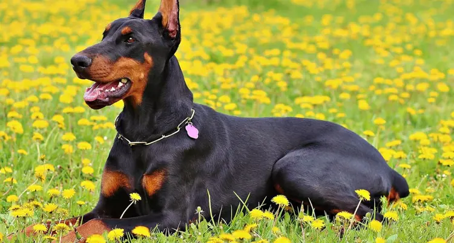
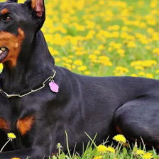
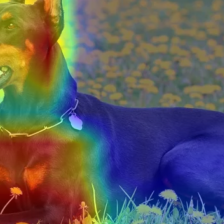

# Minh chứng resize/crop trên ảnh Doberman — Kiệt

Trong khi kiểm tra ứng dụng Gradio Task 06, Kiệt cung cấp ảnh Doberman dưới đây để quan sát vùng ảnh thực sự được đưa vào mô hình. Đây là ảnh thử do Kiệt cung cấp, không phải kết quả chạy lại Official Test.

Ứng dụng sử dụng đúng shared preprocessing: RGB → Resize(256) → CenterCrop(224) → ToTensor → ImageNet Normalize. Cấu hình này được giữ nguyên trong phần bàn giao.

## Trước và sau tiền xử lý

Ảnh gốc có kích thước **750 × 402**. Resize(256) giữ tỷ lệ ảnh và tạo kích thước **477 × 256**; CenterCrop lấy vùng giữa **224 × 224**. Sau crop, phần mõm bên trái và các phần thân/chân sát mép không còn đầy đủ trong ảnh mô hình nhìn thấy.

| Trước tiền xử lý — 750 × 402 | Sau Resize + CenterCrop — 224 × 224 |
|---|---|
|  |  |

## Grad-CAM trên vùng ảnh đã bị cắt

Grad-CAM được tạo bằng module của Thuận trên cùng checkpoint E4 seed 42, căn chỉnh với vùng CenterCrop. Lớp được giải thích là Top-1 của mô hình trong lượt thử này (Gordon Setter, confidence khoảng 77,49%, ACCEPT).

Ảnh được Kiệt xác nhận là Doberman, một giống không nằm trong 30 lớp của mô hình. Vì vậy, ví dụ này chỉ minh họa **nội dung đối tượng bị loại khỏi đầu vào do crop**; không chứng minh crop là nguyên nhân duy nhất của dự đoán và không dùng để tính accuracy Official.

## Ghi nhận gửi trưởng nhóm

Đề nghị trưởng nhóm xem xét tác động của Resize(256) kết hợp CenterCrop(224) đối với ảnh có đối tượng không nằm trọn ở trung tâm: mô hình có thể mất những phần quan trọng trước khi dự đoán. Ba ảnh trên là minh chứng cho trường hợp Kiệt đã gặp khi thử ứng dụng. Nếu cần thay đổi quy trình này, quyết định thuộc nhóm trưởng; phần Gradio bàn giao tiếp tục tuân thủ cấu hình đã khóa.
