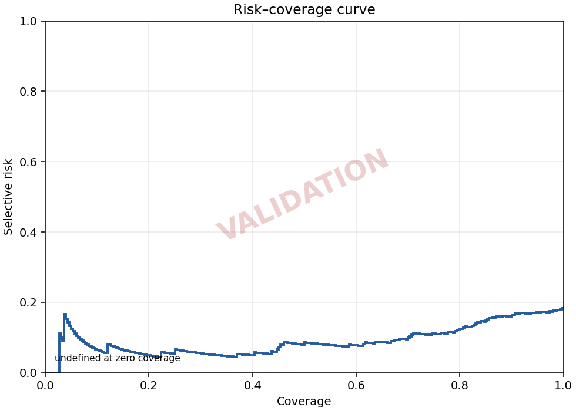

# Task Report — Task 04 / Final Selective Prediction Integration

## A. Thông tin và trạng thái

- Thành viên: Nguyễn Anh Kiệt.
- Ngày thực hiện: 22/10/2026, giờ Việt Nam (UTC+7).
- Branch: `kiet-task04-final-selective`.
- Main/base commit khi bắt đầu: `b14bb172ce24e2a22a71dbbfa03292c1c0292a57` — đã tích hợp Task 04 inference của Thuận qua [PR #15](https://github.com/DGiang1126/dogbreedid-cv-project/pull/15).
- Phạm vi hiện tại: **Giai đoạn 5 — Rà soát cuối và bàn giao PR**. Các mục B–G giữ lại bằng chứng giai đoạn 1, mục I–J là snapshot giai đoạn 2–3, mục K ghi Validation/provenance, mục L tổng hợp nghiệm thu nội bộ và bàn giao.
- Giai đoạn 1: **Completed về chuẩn bị và rà soát; còn một phát hiện provenance chưa được xác minh**.
- Audit root: **25 PASS, 1 FAIL trong 26 nhóm kiểm tra**. FAIL thuộc source triển khai tại Git SHA trong metadata, không phải lỗi shape/ID/nhãn của NPZ.
- Nguồn source của phiên inference lịch sử đã được xác minh đầy đủ: **Chưa**. Runner giữ nguyên giới hạn này trong provenance đầu ra.
- Giai đoạn 2–4: **Completed**. Giai đoạn 5: **Rà soát nội bộ hoàn tất, đang publish sửa lỗi đọc file và chuẩn bị PR**. Regression cuối **652 tests PASS**; kết quả 649 tại mục J là snapshot trước khi thêm 3 regression cases mới. Chờ trưởng nhóm review/nghiệm thu, chưa tự merge.
- Configuration Lock vẫn **DRAFT**; Official Test chưa được phép sử dụng.

## B. Chuẩn bị và giới hạn thao tác — snapshot giai đoạn 1

1. Khôi phục checkout từ GitHub vào runtime; xác nhận local `main` và `origin/main` cùng đúng base SHA nêu trên, working tree sạch.
2. Kiểm tra nhánh Task 04 chưa tồn tại rồi tạo đúng nhánh mới từ base SHA; tạo nhánh tương ứng trên GitHub và tracking local. Không dùng lại nhánh E7 Task 03.
3. Đọc Task 04, Data Contract, Configuration Lock, Git rules và phần E7 của protocol/pipeline.
4. Đọc gói Validation từ Drive, kiểm tra ZIP và trích đúng ba thành viên sang thư mục đầu vào ngoài repository. Giữ nguyên bytes; không ghi đè file khác hoặc đưa dữ liệu gốc lên GitHub.
5. Luna viết helper audit tạm ngoài repo; root đọc helper, yêu cầu kiểm tra source theo nội dung implementation thay vì chỉ kiểm tra file tồn tại, rồi tự chạy lại.
6. Trong repo chỉ tạo báo cáo này; không sửa source, tests, configs, splits, mapping hoặc artifacts E6/E7.
7. Không tải/nạp checkpoint, không inference/train, không tính softmax/Selective Metrics/AURC, không chọn lại threshold và không mở Official Test trong giai đoạn này.

Tạo/cập nhật nhánh dùng GitHub connector đã kết nối; Git CLI dùng cho clone/fetch và kiểm tra local. Không ghi credential vào repository.

## C. Gói bàn giao Validation

Nguồn: [`data/validation_npz.zip` trên Drive](https://drive.google.com/file/d/1FqZ_0sSTXYNTvK_O45Kp3jtX8xlBRWki/view).
File ZIP có **37,711 bytes**, khớp kích thước 36.83 KB trong ảnh hướng dẫn; chỉ có ba file:

| File | Nội dung |
|---|---|
| `validation_raw_predictions.npz` | Raw logits, labels và image_ids theo Data Contract |
| `validation_metadata.json` | Nguồn E4, checkpoint hash, preprocessing, runtime và Git SHA khai báo |
| `validation_metrics.json` | Metrics Classification/Calibration do Thuận bàn giao; không phải kết quả E7 Task 04 của Kiệt |

Đường dẫn staging phục vụ các bước tiếp theo:
- ZIP: `/workspace/scratch/03f371afd155/task04_inputs/validation_npz.zip`.
- Ba file đã trích: `/workspace/scratch/03f371afd155/task04_inputs/validation/`.

Đây là staging local; nguồn có thể lấy lại từ Drive bằng link và kiểm tra hashes bên dưới, không phụ thuộc vào việc runtime giữ mãi file tạm.

| Hạng mục | Kết quả |
|---|---|
| ZIP | CRC đạt; tên thành viên duy nhất, đúng ba file, không có đường dẫn thoát thư mục hoặc symlink |
| NPZ keys | Đúng `logits`, `labels`, `image_ids`; `allow_pickle=False` |
| Logits | `float32[300,30]`, toàn bộ hữu hạn |
| Labels | `int64[300]`, giá trị 0–29 |
| Image IDs | `Unicode <U55[300]`, không rỗng, duy nhất, đường dẫn tương đối an toàn |
| Validation CSV | 300 dòng; 30 lớp, mỗi lớp 10 ảnh |
| Đối chiếu ID–label | Toàn bộ 300 cặp khớp chính xác CSV |
| Thứ tự hiện tại | Cũng khớp CSV; runner mới vẫn phải hỗ trợ đảo cả hàng và đối chiếu theo ID |
| Metadata | Split/data_status là `validation`; số mẫu/lớp đúng; trường runtime và safety nhất quán |
| Preprocessing khai báo | Resize 256, CenterCrop 224, ImageNet mean/std; khớp shared data config |
| Metrics JSON của Thuận | Schema, số mẫu/lớp và finite values đạt; không tính lại hoặc nhận làm số liệu E7 |

Đối chiếu chỉ chứng minh cấu trúc, nhận dạng và tính nhất quán của artifacts đang có. Không chứng minh độc lập rằng ảnh gốc/checkpoint/source nào đã thực sự tạo ra từng logits row.

## D. Tham số và cấu hình giữ nguyên

- Model nguồn: E4 — MobileNetV2 Frozen + CutMix, seed 42, 30 lớp.
- Checkpoint identifier: `outputs/checkpoints/E4/seed_42/best.pt`.
- SHA-256 checkpoint được metadata khai báo: `73df0cc1c5b16866d4facc910f3e4d3ab481e3f12f1681a59fa7d61e3845c47b`, khớp Configuration Lock. **Không tải hoặc hash lại checkpoint trong audit này**.
- Temperature đọc từ artifact E6: **0.80246283961825**.
- Threshold đọc từ artifact E7: **0.5011672918550012**.
- ACCEPT: `confidence >= threshold`, nhận toàn bộ ties.
- Không refit Temperature hoặc chọn lại threshold. Coverage 90% là mục tiêu đã dùng trên Calibration, không phải điều kiện để ép kết quả Validation.
- E7 YAML hiện tại khóa Calibration và output paths cũ; runner Task 04 phải được tạo riêng, tái sử dụng các hàm E7, không nới guard hoặc ghi đè kết quả cũ.

### D.1. Khác biệt hash mapping do xuống dòng

- Mapping checkout LF: `d86b3a3a232babea289070299727d20d56b8f1607593ce1aaf8b174465690c3c`.
- Metadata ghi hash `79f08f8da0d65b3cb9cf256ac3b37688e112ce84b0352e5a600861b9b2327542`.
- Dựng lại biến thể CRLF từ đúng bytes mapping LF cho đúng hash metadata. Nội dung JSON và tất cả cặp class ID–breed trong Validation CSV vẫn khớp.
- Ghi nhận đây là khác biệt biểu diễn LF/CRLF; không sửa mapping, không chuẩn hóa lại file đầu vào và không đánh dấu là đổi danh sách lớp. Việc đối chiếu byte hash trong runner sau này phải xử lý minh bạch khác biệt này, không bỏ qua kiểm tra mapping.

## E. Phát hiện provenance — Không được đổi thành PASS

Metadata ghi `git_sha = 891edf9e69a6b724bcdc20b02143888e8f35bbd8`. Commit này tồn tại và là ancestor của main, nhưng kiểm tra trực tiếp Git cho thấy:

- `scripts/run_final_inference.py`: **không tồn tại** tại SHA đó.
- `src/inference/predictor.py`: chỉ có module docstring `Shared inference pipeline for the final application.`; không có các hàm inference/export.
- Vì vậy SHA metadata không xác định đầy đủ implementation đã tạo gói Validation. Không suy diễn từ việc file có mặt ở main mới thành bằng chứng về source của phiên chạy lịch sử.

Timeline quan sát được, giờ Việt Nam:
- Metadata runtime: **22/10/2026 08:49:50**.
- Source Task 04 được ghi trong Git tại `7c65521df4c39ca269d4335ba6845fe56cfd317d`: **22/10/2026 09:03:56**.
- [PR #15](https://github.com/DGiang1126/dogbreedid-cv-project/pull/15) được merge: **22/10/2026 09:05:25**.

Báo cáo upstream `docs/task_reports/thuan/20_10_task.md` cũng đã ghi giới hạn SHA nền. Các dòng trong báo cáo đó về việc chưa có PR/merge là snapshot trước khi tích hợp; hiện GitHub đã xác nhận PR #15 merged. Giới hạn còn lại là source chính xác của phiên tạo NPZ, không phải source Task 04 hiện chưa có trên GitHub.

**Cách xử lý:** giữ nguyên ZIP, NPZ, metadata và kết quả audit FAIL. Không tự thay SHA metadata bằng SHA source mới, không sửa mã hoặc báo cáo của Thuận. Gói này đã được nhóm trưởng cung cấp để làm integration và dữ liệu đạt kiểm tra schema/ID, nên có thể tiếp tục viết tooling và tests giả lập. Khi chạy/bàn giao Validation cần ghi lại giới hạn upstream; nếu cần chứng minh đầy đủ khả năng tái lập phiên inference, cần bổ sung snapshot/log nguồn từ bên tạo artifacts hoặc ghi nhận chấp nhận giới hạn qua review. Audit này không tự tuyên bố đã giải quyết provenance.

## F. Bằng chứng audit root

- Timestamp UTC: `2026-10-22T05:22:15.188563+00:00` (**12:22:15 ngày 22/10/2026, UTC+7**).
- HEAD được audit: `b14bb172ce24e2a22a71dbbfa03292c1c0292a57`; branch `kiet-task04-final-selective`.
- Môi trường: Python 3.12.14, NumPy 2.3.5, PyYAML 6.0.3, Linux CPU.
- Root đã review helper rồi chạy lại:

```bash
python /workspace/scratch/03f371afd155/task04_stage1/audit_inputs.py --report /workspace/scratch/03f371afd155/task04_stage1/audit_inputs_root.json
```

Exit code **1**, đúng với phát hiện provenance chưa đạt. Không đổi exit code hoặc sửa dữ liệu để làm audit PASS. Đây là **26 nhóm kiểm tra đầu vào**, không phải unit/integration tests của runner mới. Chưa chạy unit/full regression suite trong giai đoạn 1.

| # | Kiểm tra thực tế | Kết quả |
|---|---|---|
| 1 | `repo_and_archive_exist` | PASS |
| 2 | `source_zip_sha256` | PASS |
| 3 | `zip_members_unique_and_exact` | PASS |
| 4 | `zip_paths_types_and_sizes` | PASS |
| 5 | `zip_crc_integrity` | PASS |
| 6 | `extract_exact_validated_members_without_overwrite` | PASS |
| 7 | `metadata_git_sha_well_formed` | PASS |
| 8 | `metadata_validation_contract` | PASS |
| 9 | `metadata_preprocessing` | PASS |
| 10 | `metadata_runtime_fields` | PASS |
| 11 | `metadata_model_and_calibration_lock` | PASS |
| 12 | `metadata_safety_flags` | PASS |
| 13 | `metadata_mapping_hash_recorded` | PASS |
| 14 | `metrics_schema_finite_counts_only` | PASS |
| 15 | `npz_exact_keys_allow_pickle_false` | PASS |
| 16 | `npz_shapes_and_dtypes` | PASS |
| 17 | `npz_finite_logits_and_label_range` | PASS |
| 18 | `npz_image_ids_safe_nonempty_unique` | PASS |
| 19 | `validation_csv_rows_and_class_balance` | PASS |
| 20 | `class_mapping_30_classes_and_csv_names` | PASS |
| 21 | `npz_csv_exact_id_label_pair_set` | PASS |
| 22 | `npz_csv_order_audit` | PASS |
| 23 | `metadata_source_commit_exists_ancestor_main` | PASS |
| 24 | `runner_and_predictor_implementation_at_metadata_sha` | FAIL |
| 25 | `frozen_reference_files_available` | PASS |
| 26 | `configuration_lock_and_frozen_E6_E7_artifacts` | PASS |

## G. Nhận dạng bytes đầu vào và tham chiếu

ZIP SHA-256: `6fab7ac8791e63bf75740147ab8cf75c3b24595e5cd68bdaa8cb0932253f3a1e`.

| File trong ZIP | SHA-256 |
|---|---|
| `validation_metadata.json` | `07e179e125f5d5f5c15e64e087fdf82036351a2695e405b1e286d55d4997eb77` |
| `validation_metrics.json` | `1c0f46c05268d59ae4258e58d5e460823d36d0b2775815e636a51431aeb7d2ce` |
| `validation_raw_predictions.npz` | `5aae305b3a29e842fad313b5f3eae6edc1e2d3ca31b6e9228f4bc9c17442682a` |

Validation CSV SHA-256: `3f6dbe00e9c120d8c7acabcaa658830011beb1ea989949a07471542ac95c8d13`.

Các tham chiếu đã hash để kiểm tra thay đổi trước execution:

| File | SHA-256 |
|---|---|
| `configs/data.yaml` | `add251840c7c6ca71f9d7e99bc9510b232b90afd2842ec0984535ade590d8bb7` |
| `configs/experiments/e4_cutmix.yaml` | `9d815e385fbfc84264f57b51c8c60a36e2e3690cc558a2eb97a6ebd61a99c7a6` |
| `configs/experiments/e6_calibration.yaml` | `d47e36771c26a98d4fdef34010ac20828162410b98665b8e0f5a85a167906421` |
| `configs/experiments/e7_selective_prediction.yaml` | `6bc90bf168675f76720f8e94659760ef6cd1b9ad25502366f95764480fda4ec9` |
| `configs/model_selection.yaml` | `dcd08500e556650e67f6b98062a6407bed1caaebc7d1ed63bb3337a7bd31f332` |
| `docs/final_evaluation/configuration_lock.md` | `d16ee34a66a3127c7ec961dd36c3035591bbbe6d21aa9f9f892c30318997f33b` |
| `docs/final_evaluation/data_contract.md` | `30ae73dc129806d6e4fb9d922c9e413b912d117b347bf739d92193c24931d09c` |
| `docs/protocol/evaluation_protocol.md` | `d47c937d45bc8b02b3a1254bc3116ef57158d4ba388fd6c4ec5bd5d0c8303b1f` |
| `docs/team_tasks/19_10_task.md` | `af85996715d0779dcfdd1ef05e26bb26f6d316055065e648aed3eb0e16642eda` |
| `outputs/predictions/E6/calibration_metadata.json` | `3dd21a26efd9e4b1eaf4c4b4f0a1c81cd80a2fbf9019eaf539c3567096a6edde` |
| `outputs/metrics/E6/temperature.json` | `867a9389084e06330ef04e9d286e53cf932790db2cee2df71cb735b8bf4adc4d` |
| `outputs/metrics/E7/threshold.json` | `dcf037dee5a35db9f9d302ab43051153258d4d209be58a07430e70b736e0d6ea` |
| `outputs/metrics/E7/selective_metrics.json` | `703970086662d859335e7b67893e3e145ea237007c02a00f87e01148acf9dccd` |
| `outputs/metrics/E7/risk_coverage.csv` | `0966bbeb8b7d1fe2e52fcc4f93b6f4c70582fc3ece9ff8d9aca3903a49a15e35` |
| `outputs/figures/E7/risk_coverage_curve.png` | `c5ec535a3cfa30e3664c39c8e5caeea8f42c689e98d1eb32cb55f5da1b2b53b3` |

Không có hashes checkpoint thực đo mới ở đây; giá trị checkpoint tại D là giá trị đối chiếu từ metadata và tài liệu đã chốt.

## H. Các giai đoạn và trạng thái bàn giao

1. **Giai đoạn 2:** tạo `scripts/run_final_selective.py`, đọc NPZ/metadata, đối chiếu từng cặp ID–nhãn với split cho phép, đọc T/threshold từ artifacts và tái sử dụng E7. Không tính lại ngưỡng. Chỉ cho phép synthetic/Validation, có guard từ chối Official Test.
2. **Giai đoạn 3:** rà soát runner/tests đã tạo tại giai đoạn 2, bổ sung kiểm thử nếu có thiếu sót và chạy regression toàn repo. Các tests tích hợp trực tiếp của runner được triển khai ngay cùng source ở giai đoạn 2 để phát hiện lỗi trước khi bàn giao.
3. **Giai đoạn 4:** sau khi source đã kiểm thử và publish, chạy Validation trong output directory riêng, đối soát kết quả và ghi đầy đủ source SHA của Kiệt cùng provenance/hash đầu vào upstream. Không thay artifacts Calibration.
4. **Giai đoạn 5:** hoàn thiện báo cáo này, commit/push kết quả và tạo PR Task 04 để nhóm trưởng review; không tự merge.

Giai đoạn 1 commit báo cáo, giai đoạn 2 bổ sung source/tests, giai đoạn 3 xác minh full regression. Validation ở mục K và rà soát/bàn giao cuối ở mục L. Trạng thái PR được cập nhật tại mục A/L; Configuration Lock vẫn DRAFT.

## I. Giai đoạn 2 — Runner và synthetic integration tests

### I.1. Phạm vi và giao diện

- Root phụ trách thiết kế, review và xác minh; hai subagent **Luna** triển khai độc lập runner và tests theo yêu cầu của Kiệt.
- Chỉ bổ sung `scripts/run_final_selective.py`, `tests/test_final_selective.py` và cập nhật báo cáo cá nhân này. Không sửa source/configs/artifacts E6/E7 đã nghiệm thu hoặc file của thành viên khác.
- API đọc: `load_prediction_bundle(predictions_path, metadata_path, *, split="validation", split_csv=None, repo_root=None)`.
- API chạy: `run_final_selective(predictions_path, metadata_path, output_dir, *, split="validation", split_csv=None, repo_root=None)`.
- CLI nhận `--predictions`, `--metadata`, `--output-dir`; tùy chọn `--split validation|synthetic`, `--split-csv`, `--repo-root`. Chạy được từ thư mục làm việc khác repository.

Reader kiểm tra NPZ đúng ba keys, dtype/shape, giá trị hữu hạn, labels 0–29, IDs an toàn/duy nhất và từng cặp ID–label theo CSV. Khi cả hàng bị đảo thứ tự hợp lệ, reader sắp lại theo ID của CSV mà không thay liên hệ logits–label–ID. Validation bắt buộc CSV canonical và 300 mẫu; synthetic dùng CSV fixture tách biệt, số mẫu khác bội số batch vẫn được giữ đủ.

Metadata Validation được đối chiếu với cấu trúc producer đang có: checkpoint identifier/hash, temperature source, shared preprocessing và runtime/safety. Hash mapping và liên kết E7–E6 chỉ chấp nhận bytes chính xác hoặc biến thể chỉ khác LF/CRLF, có trường ghi rõ chế độ khớp; không sửa file để ép khớp hash. Việc metadata hợp lệ không biến thành chứng minh độc lập cho phiên inference lịch sử.

### I.2. Tính toán và đầu ra

Runner đọc T và cutoff trực tiếp từ artifacts, tái sử dụng các hàm E7 hiện có: `calibrated_predictions`, `accept_mask`, `selective_metrics`, `risk_coverage_curve`, `compute_aurc`. Không import/gọi `select_threshold`, không refit E6, không huấn luyện hoặc inference model. Coverage trên dữ liệu mới được báo cáo theo cutoff cũ; không ép về 90%.

Ba file được tạo trong một output directory mới:

| File | Nội dung |
|---|---|
| `selective_metrics.json` | Counts, Coverage, Selective Accuracy/Risk, AURC, T/cutoff, hashes, source SHA và provenance upstream |
| `risk_coverage.csv` | Origin coverage 0 với risk/accuracy/threshold trống và các nhóm confidence ties đầy đủ |
| `risk_coverage_curve.png` | Bậc thang dùng post-group risk trên từng khoảng coverage, khớp quy ước AURC E7 |

Synthetic được đánh dấu rõ và chạy ngoài source checkout với reference root/CSV fixtures riêng. Validation execution yêu cầu runner, E7 modules và các tham chiếu liên quan được tracked, không khác HEAD trong source checkout. Source SHA của runner lấy từ checkout source thực, không lấy từ fixture root hoặc gán bằng upstream SHA. Synthetic ghi rõ chưa kiểm tra trạng thái source clean.

Runner từ chối Official Test qua split/path trước khi đọc input, từ chối symlink trong đường dẫn input/reference/output, bảo vệ vị trí artifacts cũ và Final Evaluation. Không ghi đè directory đã tồn tại. Nếu ghi file bị lỗi, chỉ dọn các file/directory do lần chạy đó tạo; không nhận đây là giao dịch atomic và không xóa directory do tiến trình khác tạo.

### I.3. Bằng chứng kiểm thử

Root đã chạy trực tiếp trên source/tests sau review. Chỉ dùng fixtures giả lập, gồm một bộ 300 hàng để kiểm tra schema Validation ở API đọc; **không tính Selective Metrics trên gói Validation thật đã nhận từ Drive**.

Môi trường: Python 3.12.14, NumPy 2.3.5, PyYAML 6.0.3, Matplotlib 3.10.8, pytest 9.1.1, Linux CPU. pytest được cài vào virtual environment riêng, không thay interpreter mặc định hoặc cài Torch/GPU cho bước này.

```bash
PYTEST_DISABLE_PLUGIN_AUTOLOAD=1 /workspace/scratch/03f371afd155/task04_stage2_env/bin/python -m pytest tests/test_final_selective.py tests/test_selective_prediction.py -q -W error
```

Kết quả: **282 passed, 0 failed, 0 skipped**, exit code **0** (46 tests mới và 236 tests E7 cũ), 4.44 giây. Sau đó root điều chỉnh riêng cách vẽ `stairs(baseline=None)` để không có đoạn thẳng giả về risk 0 tại hai đầu; chạy lại toàn bộ **46 tests của runner mới: 46 passed**, 2.21 giây, exit code **0**. `py_compile` của hai file mới và `git diff --check` đều đạt. Đây là targeted regression cho E7 và runner mới, chưa phải full suite của repository.

Các nhóm kiểm tra chính:

| Nhóm | Bằng chứng |
|---|---|
| Contract NPZ | Từ chối thiếu/thừa key, object/pickle, float16/int logits, int32/uint64 labels, byte IDs, shape sai, NaN/Inf, nhãn ngoài khoảng |
| Nhận dạng và alignment | Phát hiện ID trùng/không an toàn/bị đổi hoặc tráo nhãn; đảo cả hàng hợp lệ giữ nguyên metrics và CSV curve |
| Metadata Validation | Fixture 300 hàng dùng schema producer; từ chối preprocessing không phải object, model/builder/split mâu thuẫn hoặc thiếu |
| Source guard | Git được mock để kiểm tra đủ HEAD + tracked + clean; thiếu một điều kiện đều từ chối, không chạy dữ liệu Validation thật |
| Tham số đã nghiệm thu | Cấm gọi chọn threshold mới; giữ cutoff cũ khi Coverage thấp hơn 90%; confidence bằng cutoff vẫn ACCEPT |
| Metrics và ties | Không ACCEPT, ACCEPT toàn bộ, số mẫu không chia hết batch và AURC với lỗi dự đoán/ties tính tay |
| Hash và path | LF/CRLF mapping/T/config; thay giá trị T bị từ chối; split/path Official Test và symlink bị chặn |
| Xuất file | Đủ JSON/CSV/PNG; input/artifacts giữ nguyên; không ghi đè; rollback sau partial write và không xóa directory của tiến trình khác |
| CLI và provenance | Chạy từ CWD khác, output có cờ synthetic, source HEAD lấy từ source checkout, không nhận fixture là inference model |

Ví dụ kiểm chứng độc lập gồm 6 hàng, logits class 0 có margins `[6,6,4,4,1,1]`, các logits còn lại bằng 0, labels `[0,1,2,3,4,5]`. Cutoff cũ nhận 4 hàng với 1 hàng đúng: Coverage **2/3**, Selective Accuracy **1/4**, Selective Risk **3/4**. Ba nhóm ties có risk lần lượt **1/2, 3/4, 5/6**, mỗi nhóm tăng coverage **1/3**, nên AURC là **25/36 ≈ 0.69444444**. JSON và CSV khớp kết quả tính tay; root mở PNG xác minh bậc thang và nhãn SYNTHETIC. Các số này chỉ là fixture kiểm thử, không phản ánh chất lượng E4 trên dữ liệu thật.

Trong review, root đã phát hiện và yêu cầu sửa lỗi metadata dùng sai vị trí field, kiểm tra HEAD chưa khởi tạo biến, model mâu thuẫn bị lọt, và bậc thang không khớp diện tích AURC. Các sửa đổi liên quan đã có tests hoặc đối chiếu hình trực tiếp. Root cũng đối chiếu lại **15 hashes tham chiếu tại mục G**, Validation CSV và ba file upstream: giữ nguyên bytes.

Source/tests được kiểm tra tại parent HEAD `52af04b4a1bc1ed6b71d9d86a1084bd07def0bd0` khi còn là thay đổi chưa commit; không ghi SHA đó thành bằng chứng source clean của synthetic run. Commit chứa mục I cùng runner/tests là snapshot source để bước sau review và thực thi. Không đưa fixture/output tạm vào artifacts E7 đã nghiệm thu.

### I.4. Giới hạn và bước kế tiếp — snapshot cuối giai đoạn 2

- Audit đầu vào giai đoạn 1 vẫn là **25 PASS / 1 FAIL**; nguyên nhân provenance tại mục E chưa được giải quyết bằng tests synthetic.
- Chưa chạy full regression toàn repo ở giai đoạn 2, chưa chạy Validation thật, chưa tạo PR và chưa khóa Configuration Lock.
- Giai đoạn 3 sẽ review tổng thể và chạy full regression trước khi triển khai Validation ở giai đoạn 4. Không cần GPU/Kaggle cho bước đọc logits và tính E7 này.

## J. Giai đoạn 3 — Rà soát tổng thể và full regression

### J.1. Phạm vi và đối chiếu quy tắc

- Ngày xác minh: **22/10/2026, giờ Việt Nam (UTC+7)**.
- Source runner được review/chạy tại commit `d1326665c5f179d63e0b2e9f38ae07354b17a9f3`; đây là commit giai đoạn 2 đã publish. Tests có bổ sung chưa commit khi chạy, được đưa cùng báo cáo này vào commit giai đoạn 3; không nhận HEAD cũ là SHA của tests mới.
- GitHub xác nhận `main` vẫn là `b14bb172ce24e2a22a71dbbfa03292c1c0292a57`, nhánh cá nhân tiếp tục từ commit giai đoạn 2. Không phát sinh yêu cầu mới trên main trong lần kiểm tra này.
- Root đã đọc ảnh quy tắc được cung cấp lại: dùng shared pipeline, chỉ sửa file được giao, có outputs/report/PR để nhóm trưởng review. Ảnh liên kết Task 01/10 và deadline 04/10 là hướng dẫn cũ; phạm vi hiện tại vẫn theo Task 04 tại `docs/team_tasks/19_10_task.md`, Data Contract và Configuration Lock đang DRAFT.
- Root review thiết kế và bằng chứng; **Luna** bổ sung tests. Giai đoạn 3 chỉ sửa `tests/test_final_selective.py` và báo cáo cá nhân này. Không cần sửa runner sau full review; không sửa thuật toán/source chung, configs, dữ liệu hoặc artifacts đã nghiệm thu.

### J.2. Kiểm thử bổ sung

Thêm **7 test cases** có mục đích cụ thể, nâng số tests runner từ **46 lên 53**:

1. NPZ có labels thiếu hàng, IDs thiếu hàng, labels hai chiều, IDs hai chiều và N bằng 0 đều bị từ chối: 5 cases.
2. Logits float64 hợp lệ được đọc và giữ đúng dtype, không hạ xuống float32: 1 case.
3. Tích hợp qua biên bàn giao thật của source: gọi `src.inference.predictor.save_raw_predictions` và `load_raw_predictions`, xuất NPZ synthetic float64 với thứ tự hàng bị đảo; reader của Kiệt khôi phục đúng ID–label–logits theo CSV, sau đó runner xuất đủ ba file: 1 case.

Case tích hợp dùng fixture 6 hàng ở mục I.3: Coverage **2/3**, Selective Accuracy **1/4**, Selective Risk **3/4**, AURC **25/36**. Các giá trị được đối chiếu bằng công thức, không lấy output của một lần chạy làm expected cho lần chạy khác. Chỉ dùng exporter NPZ, không chạy inference E4 và không tải checkpoint thật. Điều này chứng minh tương thích định dạng giữa hai thành phần, không chứng minh nguồn phiên inference lịch sử tại mục E.

### J.3. Full regression trên CPU

Để chạy các tests chung cần Torch, cài cặp wheel CPU từ index chính thức `https://download.pytorch.org/whl/cpu` vào virtual environment riêng đã dùng ở giai đoạn 2. Không thay `requirements.txt`, không cài lên máy người dùng và không dùng Kaggle/GPU.

| Thành phần | Phiên bản kiểm thử |
|---|---|
| Python / pytest | 3.12.14 / 9.1.1 |
| PyTorch / torchvision | 2.14.1+cpu / 0.29.1+cpu |
| NumPy / pandas | 2.3.5 / 2.2.3 |
| SciPy / scikit-learn | 1.17.0 / 1.8.0 |
| Pillow / PyYAML / Matplotlib | 12.3.0 / 6.0.3 / 3.10.8 |

Lệnh full suite, chạy từ repository root:

```bash
OMP_NUM_THREADS=2 MKL_NUM_THREADS=2 PYTEST_DISABLE_PLUGIN_AUTOLOAD=1 /workspace/scratch/03f371afd155/task04_stage2_env/bin/python -m pytest tests -q -W error --junitxml=/workspace/scratch/03f371afd155/task04_stage3_checks/full_regression.xml --basetemp=/workspace/scratch/03f371afd155/task04_stage3_checks/pytest
```

Kết quả root: **649 passed trong 13.62 giây**, exit code **0**; **0 failures, 0 errors, 0 skipped**, warnings được coi là lỗi. JUnit XML được root đọc lại để đối chiếu counts. Bao gồm 53 cases của runner mới, 236 cases E7 đã có và 360 cases còn lại trong repository: dữ liệu/transforms, models/E4, training/CutMix, metrics/efficiency, E5, E6, final inference và E8. Không sửa hoặc loại tests có sẵn để đạt kết quả này.

Các tests sử dụng dữ liệu/tensors/model fixtures, model smoke test không tải pretrained weights. Các bước training trong unit tests chỉ kiểm tra vòng lặp trên model giả nhỏ; không huấn luyện lại E4 hoặc thay checkpoint dự án. Chưa tính Selective Metrics trên gói Validation thật trong giai đoạn 3.

### J.4. Kiểm tra độc lập của root và kết luận

- Gọi riêng source execution guard với Git thực tại checkout: runner cùng tham chiếu được tracked/clean tại HEAD nên **PASS**; thao tác này không đọc predictions và không tính metrics.
- Kiểm tra AST runner: không có tên `select_threshold` hoặc `fit_temperature`. Tiếp tục tái sử dụng thuật toán E7 đã nghiệm thu.
- Đối chiếu lại **18 hashes tại các bảng mục G**: 15 file tham chiếu và 3 file đầu vào upstream đều giữ nguyên bytes. CSV/mapping và ba modules E7 không có thay đổi trong diff so với main.
- `git diff --check` đạt; toàn bộ diff của nhánh so với main chỉ gồm runner/tests được giao và báo cáo cá nhân. Main, Official Test và Configuration Lock không bị sửa hoặc mở khóa.

**Giai đoạn 3 hoàn thành**, đủ điều kiện chuyển sang giai đoạn 4 chạy Validation trong thư mục riêng sau khi publish cập nhật tests/report. Audit giai đoạn 1 vẫn giữ **25 PASS / 1 FAIL** về provenance upstream; full regression PASS không giải quyết hoặc che đi giới hạn này. Tại thời điểm kết thúc giai đoạn 3 chưa có Validation Selective Metrics mới, chưa tạo PR và chưa tuyên bố hoàn thành toàn Task 04.

## K. Giai đoạn 4 — Validation Selective Prediction

### K.1. Ghi chú cho trưởng nhóm về provenance upstream

**Theo yêu cầu của Kiệt: giữ nguyên gói Validation đã bàn giao, tiếp tục integration và nêu rõ điểm này để trưởng nhóm review.**

Metadata gốc khai báo Git SHA `891edf9e69a6b724bcdc20b02143888e8f35bbd8`; tại SHA đó chưa có đầy đủ implementation inference tạo NPZ. Code hoàn chỉnh được publish sau timestamp của lần inference được ghi trong metadata (timeline tại mục E). Chưa có snapshot/log xác nhận chính xác source đã thực thi trong lần chạy lịch sử. Đây là giới hạn về khả năng truy vết/tái lập phiên inference upstream, không phải lỗi schema hoặc ID–label của gói NPZ.

Không thay SHA hoặc chỉnh sửa artifacts của Thuận. Output Validation mới tiếp tục ghi upstream SHA gốc và trạng thái `historical execution not independently verified`; checkpoint chỉ được đối chiếu qua metadata, không được Kiệt tải hoặc hash lại. Nguồn code tính E7 của Kiệt được ghi riêng và xác định đầy đủ ở mục K.2. Kết quả đối soát số học dưới đây không được dùng để đổi phát hiện audit giai đoạn 1 thành PASS.

### K.2. Phiên chạy và đầu vào

- Source execution commit: **`5baa2713cf89c71582eff39e67af2ab307466d6f`**, đã publish trước khi chạy; working tree sạch tại đầu phiên, runner/E7 modules cùng các references liên quan tracked và không khác HEAD.
- Thời điểm bắt đầu xuất kết quả: **22/10/2026 13:16:29, giờ Việt Nam (UTC+7)**; JSON ghi `2026-10-22T06:16:29.988444+00:00`.
- Input: nguyên gói Validation từ Drive tại mục C/G, `float32[300,30]`, 300 ID–label khớp CSV canonical. Hash NPZ và metadata giữ nguyên như mục G.
- T = **0.80246283961825**, cutoff = **0.5011672918550012**, đọc trực tiếp từ E6/E7 artifacts; ACCEPT theo `>=`. Không refit hoặc chọn lại ngưỡng.
- Hash T khớp exact; metadata mapping khớp biến thể **CRLF** của mapping LF trong checkout. Đây chỉ là khác xuống dòng đã xác minh, không thay mapping.
- Môi trường tính E7: Python 3.12.14, NumPy 2.3.5, PyYAML 6.0.3, Matplotlib 3.10.8, Linux CPU. Không nạp model/checkpoint, không inference/train lại, không dùng Kaggle/GPU hoặc Official Test.
- Output directory mới: `outputs/metrics/task04_validation_selective/2026-10-22_5baa271/`. Không ghi vào E7 Calibration hoặc vị trí Official Final Evaluation.

Lệnh đã chạy từ repository root, exit code **0**:

```bash
/workspace/scratch/03f371afd155/task04_stage2_env/bin/python scripts/run_final_selective.py --predictions /workspace/scratch/03f371afd155/task04_inputs/validation/validation_raw_predictions.npz --metadata /workspace/scratch/03f371afd155/task04_inputs/validation/validation_metadata.json --split validation --output-dir outputs/metrics/task04_validation_selective/2026-10-22_5baa271
```

Để chạy lại ở checkout khác, lấy lại gói ZIP tại mục C, xác minh hashes mục G, dùng source commit nêu trên, thay đường dẫn đầu vào theo nơi giải nén và chọn **output directory chưa tồn tại**. Không sửa JSON kết quả cũ để đổi source SHA thành commit chứa artifacts sau này.

### K.3. Kết quả Validation

| Chỉ số | Kết quả |
|---|---:|
| Số mẫu | 300 |
| ACCEPT / REJECT | 261 / 39 |
| Đúng / sai trong ACCEPT | 220 / 41 |
| Coverage | **87.00%** |
| Selective Accuracy | **84.2911877395%** |
| Selective Risk | **15.7088122605%** |
| AURC, grouped right-step | **0.09093638678902743** |
| Top-1 khi nhận toàn bộ | **245/300 = 81.6666666667%** |

Độ chính xác trong nhóm ACCEPT tăng khoảng **2.62 điểm phần trăm**, đổi lại từ chối **13%** mẫu. Trong 39 mẫu REJECT, mô hình dự đoán đúng 25 và sai 14; REJECT không đồng nghĩa dự đoán sai hoặc ảnh ngoài 30 giống đã học. Đây là kết quả tích hợp trên Validation, chưa phải Official Final Evaluation.

Coverage 87% phù hợp với quy trình giữ nguyên cutoff đã chọn trên Calibration. Mục tiêu 90% thuộc bước lựa chọn threshold Calibration, không phải điều kiện phải ép đạt trên Validation. Không thay T/cutoff để tăng Coverage hoặc Selective Accuracy.

### K.4. Đối soát và tính tái lập

Luna viết helper audit tạm ngoài repository; root đọc toàn bộ helper và tự chạy lại. Helper không import runner hoặc `src.selective`, tính độc lập softmax float64, phân nhóm confidence bằng nhau, prefix correctness và tổng diện tích bậc thang từ raw NPZ. Expected metrics được tính từ dữ liệu, không hardcode các kết quả quan sát được.

Root audit lúc **22/10/2026 13:20:24, UTC+7** (`2026-10-22T06:20:24.219354+00:00`): **25/25 checks PASS**, exit code **0**. Đây là audit tính toán/đầu ra giai đoạn 4, khác với audit đầu vào giai đoạn 1 vẫn có 1 FAIL về source lịch sử.

| Nội dung đối soát | Kết quả |
|---|---|
| Số mẫu, ID–label và thứ tự CSV | 300/300 khớp |
| Counts và Selective Metrics | Khớp JSON; số nguyên so sánh exact, số thực sai số tuyệt đối tối đa cho phép `2e-12` |
| AURC độc lập | `0.09093638678902743`, khớp JSON |
| CSV Risk–Coverage | Đối chiếu toàn bộ **301 hàng**: origin + 300 confidence groups; counts, metrics và threshold đạt |
| Origin | Coverage 0; accuracy/risk/threshold trống, không gán thành 0 |
| Biên ACCEPT | Confidence nhỏ nhất trong ACCEPT: `0.5031449784469243 >= 0.5011672918550012` |
| Biên REJECT | Confidence lớn nhất trong REJECT: `0.4979750727906271 < 0.5011672918550012` |
| Top-1 toàn bộ | 245/300; khớp upstream Classification Top-1 trong sai số `1e-7` do lưu float32 |
| PNG | Signature và Pillow decode đạt; root mở hình, xác minh nhãn VALIDATION và bậc thang |
| Nguồn và trạng thái | Source SHA, input hashes, cờ Validation/preparation và giới hạn upstream khớp |

Chạy lại đúng CLI với cùng source/input vào directory mới ngoài repo `task04_stage4_checks/repeat_5baa271`: exit code **0**. JSON có mọi field giống nhau, ngoại trừ timestamp và output paths; **CSV và PNG giống từng byte**. Không ghi đè lần chạy đầu.

Root đối chiếu lại **18 hashes trong các bảng mục G** sau execution: 15 tham chiếu gốc và 3 file đầu vào vẫn giữ nguyên bytes. Audit helper cũng kiểm tra không thay đổi các file được đọc trong quá trình audit. Source/tests của Kiệt không cần sửa ở giai đoạn 4; full regression **649 PASS** ở mục J áp dụng cho đúng phiên bản source thực thi này.

Helper và log audit phục vụ kiểm tra tại runtime, không đưa thêm file Python vào repository ngoài phạm vi task. Lệnh chính ở K.2 và source commit cho phép tái tạo metrics từ gói Drive; cách kiểm chứng độc lập là so sánh counts theo ACCEPT `>=` và tính `sum_g risk_g * (coverage_g - coverage_previous)` trên toàn bộ các nhóm confidence bằng nhau.

### K.5. Artifacts bàn giao

| File | Bytes | SHA-256 |
|---|---:|---|
| [selective_metrics.json](../../../outputs/metrics/task04_validation_selective/2026-10-22_5baa271/selective_metrics.json) | 3312 | `80e7bf166c5878ead1e11c7069e5412fdcce812c83e5fff04aaf31bf2c0f2f5a` |
| [risk_coverage.csv](../../../outputs/metrics/task04_validation_selective/2026-10-22_5baa271/risk_coverage.csv) | 25542 | `49a3efb249a4fbe5acffe4ad284d680af866c5dce58d1879009aa1d62920f911` |
| [risk_coverage_curve.png](../../../outputs/metrics/task04_validation_selective/2026-10-22_5baa271/risk_coverage_curve.png) | 42010 | `6907c4647ec63bd7d45b8f180bfe11d6155b09ad27d41e6e4cbf1fe7973b155b` |



JSON có `split=validation`, `synthetic=false`, `official_final_evaluation=false`, `threshold_reselected=false`, source execution SHA của Kiệt, upstream SHA/hashes gốc và giới hạn provenance. CSV/PNG dùng cùng quy ước E7 đã nghiệm thu. Các đường dẫn tuyệt đối trong JSON là đường dẫn runtime của phiên chạy, không phải yêu cầu phải có cùng đường dẫn trên máy trưởng nhóm.

**Giai đoạn 4 hoàn thành.** Rà soát/bàn giao giai đoạn 5 được ghi tiếp tại mục L; chưa tự merge hoặc khóa cấu hình. Báo cáo không khẳng định trưởng nhóm đã chấp nhận hoặc giải quyết giới hạn provenance upstream.

## L. Giai đoạn 5 — Rà soát tổng quát và bàn giao review

### L.1. Phạm vi rà soát và lỗi đã xử lý

Root đối chiếu toàn bộ diff với `main`, source, tests, Data Contract, Task 04, Git rules, JSON/CSV/PNG, hashes và các liên kết của báo cáo. GitHub compare xác nhận branch không thiếu commit nào của main tại thời điểm kiểm tra; trước phần sửa cuối, nhánh có 4 commits trên base `b14bb172ce24e2a22a71dbbfa03292c1c0292a57`. Chưa có PR trùng cho nhánh này. Repository không có PR template hoặc workflow CI trong `.github`; các kết quả tests dưới đây là do root thực thi trong runtime, không nhận là GitHub CI đã chạy.

Luna audit code độc lập và tái hiện được lỗi khi nhận prediction container không hợp lệ: `.npy` trả về ndarray, ZIP hỏng gây `BadZipFile`, hoặc ZIP chứa bytes thô dưới tên ba fields. Các đầu vào này có thể làm CLI xuất traceback thay vì thông báo lỗi chuẩn. Bản sửa chỉ tác động phần đọc NPZ:

- Mở file bằng context manager do runner quản lý; đóng file cả khi `np.load` báo lỗi.
- Xác nhận đối tượng là `NpzFile`, ba fields là NumPy arrays và tiếp tục dùng `allow_pickle=False`.
- Chuẩn hóa lỗi ZIP thành `ValueError`; CLI trả status **2**, có thông báo rõ và không tạo output.
- Thêm **3 regression cases**, mỗi case kiểm tra API và CLI. Không bắt rộng `Exception`, không tắt warnings, không nới kiểm tra schema/ID hoặc sửa thuật toán E7.

Lần chạy full suite đầu sau sửa định dạng phát hiện thêm file handle bị bỏ ngỏ ở nhánh ZIP hỏng: **651 PASS / 1 FAIL** vì `PytestUnraisableExceptionWarning`. Root yêu cầu sửa quản lý handle, không bỏ test hoặc bỏ `-W error`. Kết quả cuối sau sửa ở L.3. Không phát hiện sai lệch số học hoặc thay đổi ngưỡng trong lượt rà soát này.

### L.2. Đối chiếu yêu cầu Task 04 của Kiệt

| Yêu cầu | Bằng chứng và kết luận nội bộ |
|---|---|
| NPZ đúng contract, không pickle | float32/float64 `[N,30]`, int64 labels, Unicode IDs; tests positive và malformed containers/dtype/shape/NaN/Inf/empty đạt |
| Khớp split được phép | CSV canonical Validation, đủ 300 cặp ID–label; phát hiện tráo nhãn/đổi ID và giữ metrics khi đảo cả hàng hợp lệ |
| Dùng T/cutoff artifacts gốc | Giá trị và hashes mục D/G/K; source tái sử dụng E7, không có gọi chọn lại threshold hoặc refit T |
| ACCEPT `>=`, ties và edge cases | Cases đúng bằng cutoff, grouped ties, zero/all ACCEPT, số mẫu không chia hết batch; không bỏ mẫu |
| Counts, Coverage, Accuracy, Risk, AURC | Tính tay fixtures và audit độc lập Validation 25/25; đối chiếu cả 301 hàng CSV |
| Tương thích handoff Thuận → Kiệt | Test dùng exporter `save_raw_predictions` của Thuận với float64/đảo hàng; đọc và tính thành công gói NPZ thật từ Drive |
| Tái lập kết quả | Hai lần Validation cho metrics giống nhau, CSV/PNG giống từng byte; source execution SHA/input hashes được lưu riêng |
| Bảo vệ input/output | Không overwrite directory, rollback khi partial write, không xóa directory tiến trình khác; symlink/path guards có tests |
| Không dùng Official Test | Chỉ synthetic/Validation; split/path bị chặn; cờ `official_final_evaluation=false`, Configuration Lock giữ DRAFT |
| Không sửa code chung/artifacts cũ | Diff so với main chỉ có **6 file mới**: runner, tests, report và 3 output files riêng; E6/E7 modules/configs/splits/mapping giữ nguyên |
| Tests và artifacts bàn giao | Full suite cuối 652 PASS; JSON/CSV/PNG mở/đọc được, hashes K.5 khớp, liên kết tương đối trong report hợp lệ |
| Provenance upstream | **Chưa xác minh đầy đủ** source phiên inference lịch sử; được công khai ở E/K.1 và phần lưu ý PR, không đổi SHA gốc hoặc tự tuyên bố đã giải quyết |
| Task Report và PR | Báo cáo tổng hợp này được cập nhật cùng nhánh; trạng thái PR cuối ghi tại L.4, chờ trưởng nhóm review |

Source/artifacts bàn giao không chứa checkpoint, dataset ảnh gốc, raw NPZ mới hoặc credential. Nguồn ZIP vẫn ở Drive và có hashes kiểm tra lại; ba artifacts Validation nhỏ được đưa vào Git đúng phần bàn giao của Kiệt.

### L.3. Xác minh cuối sau sửa

Root đã đọc diff sửa lỗi, chạy `py_compile`, kiểm tra whitespace và chạy lại **toàn bộ** suite sau khi Luna freeze source/tests:

```bash
OMP_NUM_THREADS=2 MKL_NUM_THREADS=2 PYTEST_DISABLE_PLUGIN_AUTOLOAD=1 /workspace/scratch/03f371afd155/task04_stage2_env/bin/python -m pytest tests -q -W error --junitxml=/workspace/scratch/03f371afd155/task04_stage5_checks/full_regression_after_fix.xml --basetemp=/workspace/scratch/03f371afd155/task04_stage5_checks/pytest_after_fix
```

Kết quả cuối: **652 passed trong 15.45 giây**, exit code **0**; **0 failures, 0 errors, 0 skipped**, warnings được coi là lỗi. Root đọc lại JUnit XML để xác nhận counts. Bao gồm **56 tests** của runner mới và **596 tests** có sẵn, không sửa các tests cũ. Môi trường giống mục J.3.

Kết quả Validation đã publish ở K vẫn gắn đúng source execution commit **`5baa2713cf89c71582eff39e67af2ab307466d6f`**. Sửa lỗi container/handle ở giai đoạn 5 không sửa phép tính E7 và không ghi đè artifacts K.5 hoặc thay execution SHA lịch sử thành SHA PR mới. Root đã đối chiếu snapshot source thực thi với source trước bản sửa, kiểm tra lại hashes/links và giữ nguyên giới hạn upstream. Các giá trị Validation tiếp tục là Coverage 87%, Selective Accuracy 84.2911877395%, Risk 15.7088122605%, AURC 0.09093638678902743.

### L.4. Trạng thái bàn giao

Đã hoàn thành triển khai và rà soát nội bộ; đang publish bản sửa/tests/report và mở PR vào `main`. PR sẽ nêu rõ kết quả Validation, 652 tests và giới hạn provenance upstream để trưởng nhóm review. Chưa tự merge, chưa khóa Configuration Lock và chưa thực hiện Official Final Evaluation. Việc triển khai/bàn giao của Kiệt không thay thế bước nghiệm thu của trưởng nhóm.
